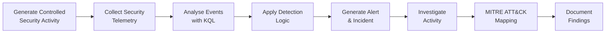

# Microsoft Sentinel Cloud SOC & Threat Detection Lab

A hands-on cloud SOC project built using **Microsoft Sentinel, Azure Log Analytics, Azure Monitor Agent, Azure Arc, Windows Security Events, and KQL**.

The project demonstrates the process of collecting endpoint security telemetry, analysing security events, developing custom detection logic, generating Sentinel incidents, and performing structured SOC investigations.

> **Status:** 🟡 In Progress

---

## Project Objectives

The objectives of this lab are to develop practical experience with:

- Microsoft Sentinel SIEM
- Azure Log Analytics
- Azure Monitor Agent (AMA)
- Azure Arc
- Windows Security Event monitoring
- Kusto Query Language (KQL)
- Security alert triage
- Detection engineering
- Sentinel Analytics Rules
- Incident investigation
- MITRE ATT&CK mapping
- Security investigation documentation

---

# Architecture

```mermaid
flowchart LR

    WIN["Windows 11 Endpoint<br/>Proxmox VM"]
    ARC["Azure Arc"]
    AMA["Azure Monitor Agent"]
    DCR["Data Collection Rule<br/>Windows Security Events"]
    LAW["Azure Log Analytics<br/>Workspace"]
    SENTINEL["Microsoft Sentinel"]
    KQL["KQL Analysis"]
    RULE["Scheduled Analytics Rules"]
    ALERT["Security Alert"]
    DEFENDER["Microsoft Defender<br/>Incident Investigation"]

    WIN --> ARC
    ARC --> AMA
    AMA --> DCR
    DCR --> LAW
    LAW --> SENTINEL

    SENTINEL --> KQL
    KQL --> RULE
    RULE --> ALERT
    ALERT --> DEFENDER
```



---

# Detection & Investigation Workflow

The project follows a structured SOC workflow:



This approach ensures the project demonstrates more than simple log collection.

The objective is to validate the complete process from **security telemetry to analyst investigation**.

---

# Environment

| Component | Purpose |
|---|---|
| **Microsoft Sentinel** | SIEM, detection and incident management |
| **Azure Log Analytics** | Centralised security log storage and querying |
| **Azure Monitor Agent** | Endpoint telemetry collection |
| **Azure Arc** | Integration of the on-premises Windows VM with Azure |
| **Windows 11** | Monitored endpoint |
| **KQL** | Security-event analysis and detection queries |
| **Microsoft Defender Portal** | Unified incident investigation interface |
| **Proxmox** | Virtualisation platform hosting the Windows endpoint |

---

# Data Collection

A Windows 11 virtual machine hosted in the local Proxmox environment was onboarded to **Azure Arc**.

Windows Security Events are collected through **Azure Monitor Agent** using a **Data Collection Rule (DCR)** and forwarded to the Azure Log Analytics workspace used by Microsoft Sentinel.

```text
Windows Security Events
        ↓
Azure Monitor Agent
        ↓
Data Collection Rule
        ↓
Log Analytics
        ↓
Microsoft Sentinel
```

KQL queries are then used to analyse and correlate the collected telemetry.

---

# Custom Detection Engineering

Microsoft Sentinel scheduled analytics rules are used to transform raw security telemetry into actionable detections.

The first custom detection monitors repeated Windows authentication failures.

### Repeated Windows Failed Logons

**Event:** Windows Security Event ID `4625`

**Detection condition:**

> Five or more failed Windows authentication events within a 10-minute period.

The detection workflow is:

```text
Event ID 4625
      ↓
KQL Correlation
      ↓
Scheduled Analytics Rule
      ↓
Sentinel Alert
      ↓
Security Incident
      ↓
Analyst Investigation
```

---

# SOC Investigations

## 01 — Repeated Windows Failed Logons

Controlled Windows authentication failures were generated against the monitored endpoint.

Windows Security Event ID **4625** captured the authentication failures and the events were analysed using KQL.

A custom Microsoft Sentinel analytics rule correlated repeated authentication failures and successfully generated an alert and incident for investigation.

The investigation included:

- Windows failed-logon analysis
- Event ID 4625 investigation
- KQL event correlation
- Custom Sentinel detection logic
- Alert and incident generation
- Authentication timeline analysis
- MITRE ATT&CK mapping
- Analyst verdict and documentation

**MITRE ATT&CK:** `T1110 — Brute Force`

**Verdict:** `True Positive — Controlled Security Test`

> Detailed investigation documentation will be available under `investigations/01-windows-failed-logons/`.

---

# KQL Analysis

KQL is used throughout the project to investigate Windows security telemetry and develop detection logic.

Example investigation query:

```kusto
SecurityEvent
| where EventID == 4625
| project
    TimeGenerated,
    Computer,
    Account,
    LogonTypeName,
    IpAddress,
    WorkstationName,
    FailureReason
| order by TimeGenerated desc
```

Repeated authentication failures can then be correlated:

```kusto
SecurityEvent
| where EventID == 4625
| summarize
    FailedLogons = count(),
    FirstAttempt = min(TimeGenerated),
    LastAttempt = max(TimeGenerated)
    by Account, Computer
| where FailedLogons >= 5
```

---

# MITRE ATT&CK Mapping

MITRE ATT&CK is applied only where the observed activity supports an appropriate technique mapping.

| Activity | Technique |
|---|---|
| Repeated Windows authentication failures | `T1110 — Brute Force` |

Additional mappings will be added as further investigations are completed.

---

# Current Progress

- [x] Azure resource group created
- [x] Log Analytics workspace deployed
- [x] Microsoft Sentinel enabled
- [x] Log ingestion cost controls configured
- [x] Windows 11 endpoint onboarded through Azure Arc
- [x] Azure Monitor Agent configured
- [x] Windows Security Events Data Collection Rule created
- [x] Windows Security telemetry successfully ingested
- [x] KQL queries validated
- [x] Custom failed-logon detection created
- [x] Sentinel alert and incident successfully generated
- [x] Investigation 01 — Repeated Windows Failed Logons
- [ ] Additional endpoint investigation
- [ ] Suspicious PowerShell investigation
- [ ] Additional detection engineering
- [ ] Final project documentation

---

# Planned Investigations

The next stages of the project will expand the SOC workflow across additional security scenarios.

Planned areas include:

- Suspicious PowerShell activity
- Windows account and privilege activity
- Additional endpoint security events
- Custom Sentinel detections
- Incident investigation and correlation

These investigations will be added only after the corresponding activity has been implemented and validated.

---

# Key Learning Areas

This project is designed to strengthen practical understanding of:

**Cloud SIEM → Endpoint Telemetry → KQL → Detection Engineering → Alert Triage → Incident Investigation**

The project also demonstrates how an endpoint outside Azure can be integrated into a cloud-based SOC using **Azure Arc and Azure Monitor Agent**.

---

# Ethical Use

All security activity documented in this repository is generated within an **authorised lab environment** using systems under my control.

The project is intended solely for cybersecurity education, defensive security research, detection engineering, and professional skills development.

---

# Author

**Amal Varghese**

Cyber Security | SOC | Blue Team | Security Engineering

[LinkedIn](https://www.linkedin.com/in/amalbuilds/)

[GitHub Portfolio](https://github.com/CyberAmal)
