# Microsoft Sentinel Cloud SOC & Threat Detection Lab

A hands-on cloud SOC project built to develop practical experience with **Microsoft Sentinel, Azure Log Analytics, KQL, detection engineering, security monitoring, and incident investigation**.

The lab integrates a Windows endpoint hosted outside Azure with Microsoft Sentinel using **Azure Arc** and **Azure Monitor Agent (AMA)**, allowing Windows security telemetry to be collected, analysed, correlated, and converted into actionable security incidents.

The project focuses on the complete SOC workflow:

**Telemetry → Analysis → Detection → Alert → Incident → Investigation → Documentation**

> **Project Status:** 🟡 In Progress

---

# Project Objectives

The primary objectives of this project are to:

- Deploy and configure Microsoft Sentinel
- Integrate an external Windows endpoint with Azure
- Collect Windows Security Events using Azure Monitor Agent
- Analyse security telemetry using KQL
- Develop custom Sentinel Analytics Rules
- Generate controlled security activity
- Investigate alerts and incidents
- Correlate authentication and endpoint telemetry
- Apply MITRE ATT&CK where supported by observed activity
- Document investigations using a structured SOC workflow

---

# Architecture

```mermaid
flowchart LR

    WIN["Windows 11 Endpoint<br/>Proxmox"]
    ARC["Azure Arc"]
    AMA["Azure Monitor Agent"]
    DCR["Data Collection Rule"]
    LAW["Log Analytics Workspace"]
    SENTINEL["Microsoft Sentinel"]
    KQL["KQL Analysis"]
    RULES["Analytics Rules"]
    ALERT["Security Alert"]
    DEFENDER["Microsoft Defender<br/>Incident Investigation"]

    WIN --> ARC
    ARC --> AMA
    AMA --> DCR
    DCR --> LAW
    LAW --> SENTINEL
    SENTINEL --> KQL
    KQL --> RULES
    RULES --> ALERT
    ALERT --> DEFENDER
```



---

# Technology Stack

| Technology | Purpose |
|---|---|
| **Microsoft Sentinel** | SIEM, detection and security incident management |
| **Azure Log Analytics** | Centralised security telemetry and querying |
| **KQL** | Security-event analysis and detection logic |
| **Azure Monitor Agent** | Windows security telemetry collection |
| **Azure Arc** | Integration of the non-Azure Windows endpoint |
| **Data Collection Rules** | Control of Windows Security Event collection |
| **Microsoft Defender Portal** | Unified alert and incident investigation |
| **Windows 11** | Monitored endpoint |
| **Proxmox** | Virtualisation platform hosting the endpoint |

---

# SOC Data Pipeline

The Windows 11 endpoint is hosted within the local Proxmox environment and onboarded to Azure using Azure Arc.

Windows Security Events are collected using Azure Monitor Agent and a Data Collection Rule before being forwarded to the Log Analytics workspace used by Microsoft Sentinel.

```text
Windows Security Events
        ↓
Azure Monitor Agent
        ↓
Data Collection Rule
        ↓
Log Analytics
        ↓
Microsoft Sentinel
        ↓
KQL Analysis
        ↓
Analytics Rules
        ↓
Alerts & Incidents
        ↓
Analyst Investigation
```

This provides a practical hybrid monitoring architecture where an endpoint outside Azure can be monitored through a cloud SIEM.

---

# Implementation

## Azure Log Analytics

A dedicated Log Analytics workspace was deployed as the central telemetry repository for the project.

A daily ingestion cap was configured to control data consumption within the lab environment.

## Microsoft Sentinel

Microsoft Sentinel was enabled on the Log Analytics workspace to provide:

- Security monitoring
- KQL-based analysis
- Analytics rules
- Alert generation
- Incident management
- Investigation workflows

## Azure Arc

The Windows 11 endpoint hosted on Proxmox was onboarded using Azure Arc.

This allowed the non-Azure endpoint to be managed as an Azure-connected machine and integrated with Azure Monitor.

## Azure Monitor Agent

Azure Monitor Agent was deployed to collect security telemetry from the Arc-enabled Windows endpoint.

## Data Collection Rule

A Data Collection Rule was configured to collect Windows Security Events and forward them to the Log Analytics workspace.

The **Common** Windows Security Event collection profile was selected to provide useful security telemetry while controlling unnecessary ingestion.

---

# KQL Analysis

Kusto Query Language is used throughout the project to investigate and correlate security events.

Example query for investigating failed Windows authentication:

```kusto
SecurityEvent
| where EventID == 4625
| project
    TimeGenerated,
    Computer,
    Account,
    LogonTypeName,
    IpAddress,
    WorkstationName,
    FailureReason
| order by TimeGenerated desc
```

KQL is also used to transform individual events into correlated security activity.

Example:

```kusto
SecurityEvent
| where EventID == 4625
| summarize
    FailedLogons = count(),
    FirstAttempt = min(TimeGenerated),
    LastAttempt = max(TimeGenerated)
    by Account, Computer
| where FailedLogons >= 5
```

---

# Detection Engineering

Custom Microsoft Sentinel scheduled analytics rules are developed to identify suspicious patterns within collected telemetry.

The first custom detection identifies repeated Windows authentication failures.

### Repeated Windows Failed Logons

**Source Event:** Windows Security Event ID `4625`

**Detection Logic:** Five or more failed authentication events associated with the same account and endpoint within a 10-minute period.

**Severity:** Medium

The detection was validated through controlled authentication failures and successfully generated a security alert and incident.

---

# SOC Investigations

Each investigation contains separate documentation, KQL evidence, screenshots, findings, MITRE ATT&CK mapping where appropriate, and an analyst verdict.

## 01 — Repeated Windows Failed Logons ✅

Controlled repeated Windows authentication failures were generated against the monitored endpoint.

Event ID `4625` telemetry was analysed using KQL and correlated through a custom Microsoft Sentinel scheduled analytics rule.

The configured detection threshold was successfully reached, generating an alert and incident for investigation through the Microsoft Defender portal.

**MITRE ATT&CK:** `T1110 — Brute Force`

**Verdict:** `True Positive — Controlled Security Test`

[View Investigation](investigations/01-windows-failed-logons)

---

## 02 — Suspicious PowerShell Activity

**Status:** Planned

The next investigation will focus on PowerShell-related endpoint telemetry, KQL analysis, detection logic, and incident investigation.

---

## 03 — Account & Privilege Activity

**Status:** Planned

This investigation will focus on Windows account and privilege-related security telemetry and event correlation.

---

## 04 — Suspicious Network / Endpoint Activity

**Status:** Planned

This investigation will examine network or endpoint activity using available security telemetry and indicators.

---

## 05 — Advanced Sentinel Detection & Incident Investigation

**Status:** Planned

The final investigation will focus on additional custom detection engineering and a structured Sentinel incident investigation workflow.

---

# MITRE ATT&CK Mapping

MITRE ATT&CK is applied only where the observed activity supports an appropriate mapping.

| Activity | Technique |
|---|---|
| Repeated Windows authentication failures | `T1110 — Brute Force` |

Additional mappings will be added as investigations are completed.

---

# Current Progress

- [x] Azure resource group deployed
- [x] Log Analytics workspace configured
- [x] Microsoft Sentinel enabled
- [x] Data ingestion limits configured
- [x] Windows 11 endpoint onboarded using Azure Arc
- [x] Azure Monitor Agent deployed
- [x] Windows Security Event collection configured
- [x] Security telemetry validated in Log Analytics
- [x] Initial KQL analysis completed
- [x] Custom Sentinel Analytics Rule created
- [x] Alert and incident generation validated
- [x] Investigation 01 — Repeated Windows Failed Logons
- [ ] Investigation 02 — Suspicious PowerShell Activity
- [ ] Investigation 03 — Account & Privilege Activity
- [ ] Investigation 04 — Suspicious Network / Endpoint Activity
- [ ] Investigation 05 — Advanced Sentinel Detection & Incident Investigation
- [ ] Final validation and documentation

---

# Key Findings

### 1. Telemetry Requires Detection Logic

Collecting Windows Security Events provides visibility, but individual events do not automatically represent actionable security incidents.

KQL correlation and analytics rules are required to identify meaningful patterns within the telemetry.

### 2. Detection Thresholds Require Context

A single failed authentication event does not represent a brute-force attempt.

The first custom detection therefore correlates multiple Event ID `4625` events within a defined time window.

### 3. Hybrid Endpoints Can Be Integrated with Cloud SIEM

Azure Arc and Azure Monitor Agent enabled a Windows endpoint hosted outside Azure to forward security telemetry into the Microsoft cloud monitoring environment.

### 4. Detection Must Be Validated

Creating an analytics rule does not prove that it works.

Controlled security activity was generated to verify the complete path from endpoint telemetry through KQL correlation to alert and incident generation.

---

# Challenges & Troubleshooting

Building the environment required troubleshooting across several areas, including:

- Windows endpoint internet and DNS connectivity
- Azure Arc onboarding
- Azure Monitor Agent deployment
- Data Collection Rule configuration
- Windows Security Event ingestion
- KQL query development
- Analytics-rule thresholds
- Scheduled detection timing
- Alert and incident generation

Troubleshooting formed an important part of the project because each stage of the monitoring pipeline needed to be validated before progressing to detection and investigation.

---

# Security Validation & Cost Control

The project was designed as a controlled security lab.

Azure data-ingestion limits were configured before security telemetry collection began to reduce unnecessary resource consumption.

Controlled security events are generated only against systems within the authorised lab environment.

Detection thresholds and collection settings are adjusted based on the requirements of each investigation rather than enabling unnecessary telemetry.

---

# What I Learned

This project strengthened my understanding of how Microsoft cloud security technologies can be combined to build a practical SOC monitoring workflow.

The project demonstrates that effective security monitoring requires more than collecting logs.

A complete workflow requires:

**Collection → Analysis → Correlation → Detection → Alert → Investigation → Validation → Documentation**

Working with Azure Arc, Azure Monitor Agent, Log Analytics, Microsoft Sentinel, KQL and the Microsoft Defender incident interface provided practical experience across both security monitoring infrastructure and analyst investigation workflows.

---

# Ethical Use

All security testing documented in this repository is performed in an authorised lab environment against systems under my control.

The project is intended solely for cybersecurity education, defensive-security research, detection engineering, and professional skills development.

---

# Author

**Amal Varghese**

Cyber Security | SOC | Blue Team | Security Engineering

[LinkedIn](https://www.linkedin.com/in/amalbuilds/)

[GitHub Portfolio](https://github.com/CyberAmal)
