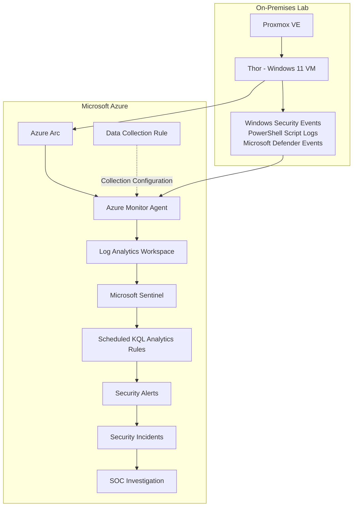
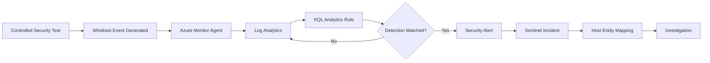

# Microsoft Sentinel Cloud SOC & Threat Detection Lab

**Microsoft Sentinel | Azure Arc | Azure Monitor Agent | KQL | Detection Engineering | Incident Investigation**

A hands-on hybrid cloud SOC project demonstrating the collection, analysis, and detection of Windows security threats using Microsoft Sentinel.

The lab integrates a Windows 11 endpoint hosted on Proxmox VE with Microsoft Azure using Azure Arc and Azure Monitor Agent (AMA). Windows Security, PowerShell, and Microsoft Defender telemetry is forwarded to Azure Log Analytics, where custom KQL analytics rules detect suspicious activity and generate security incidents.

**Project Status:** Five Security Investigations Completed

## Project Objectives

- Deploy Microsoft Sentinel and Azure Log Analytics.
- Integrate a non-Azure Windows endpoint using Azure Arc.
- Configure Windows security telemetry collection using Azure Monitor Agent and Data Collection Rules.
- Develop custom KQL threat detection queries.
- Simulate security activity in an authorised lab.
- Validate automatic security alert and incident generation.
- Investigate Windows authentication, PowerShell, malware, account privilege, and persistence activity.
- Apply MITRE ATT&CK mappings to relevant detections.

---

## Lab Architecture



### Technology Stack

| Technology | Purpose |
|---|---|
| Proxmox VE | Hosts the Windows 11 virtual machine |
| Windows 11 - Thor | Monitored endpoint |
| Azure Arc | Connects the non-Azure endpoint to Azure |
| Azure Monitor Agent | Collects Windows event telemetry |
| Data Collection Rules | Defines collected event logs |
| Azure Log Analytics | Centralised log storage and querying |
| Microsoft Sentinel | SIEM, detection, and incident management |
| KQL | Security analysis and detection logic |
| Microsoft Defender | Endpoint malware detection |
| MITRE ATT&CK | Threat technique mapping |

### Azure Configuration

| Resource | Configuration |
|---|---|
| Resource Group | `rg-sentinel-soc-lab` |
| Log Analytics Workspace | `law-sentinel-soc-lab` |
| Data Collection Rule | `dcr-thor-security-monitoring` |
| Region | UK South |
| Endpoint | Thor |
| Endpoint IP | `192.168.20.30` |

---

## SOC Detection Workflow



Security events are generated on Thor, collected through AMA, and stored in Log Analytics. Scheduled analytics rules evaluate the telemetry and generate alerts when their detection conditions are met.

Incident creation and Host entity mapping were validated for all five investigations.

---

## Implementation

### 1. Azure Log Analytics

Deployed a dedicated Log Analytics workspace in UK South for centralised security telemetry collection.

Configured data ingestion limits to control cloud resource consumption during lab testing.

### 2. Microsoft Sentinel

Enabled Microsoft Sentinel on the Log Analytics workspace for security monitoring, KQL analysis, scheduled analytics rules, alert generation, and incident investigation.

### 3. Azure Arc

Onboarded the Proxmox-hosted Windows 11 endpoint, Thor, as an Azure Arc-enabled machine.

### 4. Azure Monitor Agent

Deployed Azure Monitor Agent to collect Windows Security, PowerShell, and Microsoft Defender telemetry.

### 5. Data Collection Rule

Configured `dcr-thor-security-monitoring` to forward the required Windows event logs to Log Analytics.

The collection configuration was updated during testing to include scheduled task creation Event ID `4698`.

---

## SOC Investigations

Five controlled security scenarios were executed against the monitored Windows endpoint.

Each investigation involved event generation, log validation, KQL detection development, analytics rule configuration, and automatic incident validation.

| # | Investigation | Event IDs | Result |
|---|---|---|---|
| 01 | Repeated Windows Failed Logons | 4625 | Detected |
| 02 | Suspicious PowerShell Activity | 4104 | Detected |
| 03 | Microsoft Defender Malware Detection | 1116, 1117 | Detected |
| 04 | Account Creation & Privilege Escalation | 4720, 4732 | Detected |
| 05 | Suspicious Scheduled Task Persistence | 4698 | Detected |

### 01 - Repeated Windows Failed Logons

**MITRE ATT&CK:** `T1110 — Brute Force`

**Event ID:** `4625`

Controlled repeated SSH authentication failures were generated against the Windows 11 endpoint.

Failed authentication events were collected through Azure Monitor Agent and analysed using KQL.

A custom Microsoft Sentinel scheduled analytics rule detected five or more failed authentication attempts within a ten-minute window.

The detection successfully generated an alert and incident, with Thor identified as the affected endpoint.

**Detection Query:**

```kusto
Event
| where TimeGenerated > ago(10m)
| where EventID == 4625
| summarize
    FailedAttempts = count(),
    FirstAttempt = min(TimeGenerated),
    LastAttempt = max(TimeGenerated)
    by Computer
| where FailedAttempts >= 5
| project LastAttempt, Computer, FailedAttempts, FirstAttempt
```

**Verdict:** `True Positive - Controlled Security Test`

[View Investigation](investigations/01-windows-failed-logons)

---

### 02 - Suspicious PowerShell Activity

**MITRE ATT&CK:** `T1059.001 - PowerShell`

**Event ID:** `4104`

Executed a harmless PowerShell Base64 decoding command to simulate suspicious script execution.

PowerShell Script Block Logging captured the activity, and the telemetry was successfully forwarded to Azure Log Analytics.

A custom KQL detection rule identified suspicious PowerShell command patterns and generated a Microsoft Sentinel incident.

Thor was confirmed under incident Assets.

**Detection Query:**

```kusto
Event
| where EventID == 4104
| where RenderedDescription has_any (
    "EncodedCommand",
    "FromBase64String",
    "DownloadString",
    "Invoke-Expression",
    "IEX"
)
| project TimeGenerated, Computer, EventID, RenderedDescription
```

**Verdict:** `True Positive - Controlled Security Test`

---

### 03 - Microsoft Defender Malware Detection

**Event IDs:** `1116`, `1117`

Used the harmless EICAR antivirus test file to validate Microsoft Defender detection and remediation monitoring.

Microsoft Defender generated security events for the test file, which were collected through Azure Monitor Agent and forwarded to Log Analytics.

A custom Sentinel analytics rule successfully generated an incident associated with Thor.

**Detection Query:**

```kusto
Event
| where EventID in (1116, 1117)
| project
    TimeGenerated,
    Computer,
    EventID,
    RenderedDescription
| order by TimeGenerated desc
```

**Verdict:** `True Positive — Controlled Antivirus Test`

---

### 04 - Suspicious Account Creation & Privilege Escalation

**MITRE ATT&CK:** `T1136.001 - Create Account: Local Account` | `T1098 - Account Manipulation`

**Event IDs:** `4720`, `4732`

Created a temporary local Windows account named `SOC-TestUser` and added it to the local Administrators group.

Windows recorded the account creation and group membership modification events.

A SID-based KQL correlation query was developed to link the two events within a 15-minute window.

The analytics rule successfully detected the activity and generated a Microsoft Sentinel incident.

The account's Administrators group membership was removed after testing.

**Detection Query:**

```kusto
let Created =
    Event
    | where TimeGenerated > ago(30m)
    | where EventID == 4720
    | extend AccountSID = extract(@"S-1-5-21-\d+-\d+-\d+-\d+", 0, RenderedDescription)
    | where isnotempty(AccountSID)
    | project Computer, AccountSID, CreationTime = TimeGenerated;
let Promoted =
    Event
    | where TimeGenerated > ago(30m)
    | where EventID == 4732
    | where RenderedDescription contains "Administrators"
    | extend AccountSID = extract(@"S-1-5-21-\d+-\d+-\d+-\d+", 0, RenderedDescription)
    | where isnotempty(AccountSID)
    | project Computer, AccountSID, PromotionTime = TimeGenerated;
Created
| join kind=inner Promoted on Computer, AccountSID
| where PromotionTime between (CreationTime .. CreationTime + 15m)
| project
    TimeGenerated = PromotionTime,
    Computer,
    AccountSID,
    CreationTime,
    PromotionTime
```

**Verdict:** `True Positive - Controlled Security Test`

**Detection Note:** The SID extraction method was validated in the lab. Production implementation would require field-specific parsing to ensure accurate account correlation.

---

### 05 - Suspicious Scheduled Task Persistence

**MITRE ATT&CK:** `T1053.005 - Scheduled Task`

**Event ID:** `4698`

Created harmless Windows scheduled tasks configured to execute PowerShell commands.

Enabled Windows auditing for scheduled task creation and updated the Azure Data Collection Rule to include Event ID `4698`.

After validating successful ingestion into Log Analytics, a custom KQL analytics rule was developed to detect PowerShell-related scheduled task creation.

The rule successfully generated a Microsoft Sentinel incident, with Thor identified as the affected endpoint.

**Detection Query:**

```kusto
Event
| where EventID == 4698
| where RenderedDescription has "powershell.exe"
    or RenderedDescription has "SOC-Lab"
    or RenderedDescription has "SOC-Sentinel"
| project
    TimeGenerated,
    Computer,
    EventID,
    RenderedDescription
```

**Verdict:** `True Positive - Controlled Security Test`

---

## MITRE ATT&CK Mapping

| Investigation | Technique ID | Technique |
|---|---|---|
| Repeated Failed Logons | T1110 | Brute Force |
| Suspicious PowerShell | T1059.001 | PowerShell |
| Account Creation | T1136.001 | Create Account: Local Account |
| Privilege-related Account Modification | T1098 | Account Manipulation |
| Scheduled Task Persistence | T1053.005 | Scheduled Task |

The Microsoft Defender EICAR investigation focused on antivirus detection and remediation telemetry rather than demonstrating a specific adversary technique.

---

## Challenges & Troubleshooting

### Missing Scheduled Task Events

Event ID `4698` was initially unavailable in Log Analytics.

Verified Windows auditing, enabled the required audit policy, updated the Data Collection Rule, and generated fresh test events to confirm successful ingestion.

### Account Event Correlation

Initial username-based correlation between Events `4720` and `4732` did not return matching results.

Examined the event descriptions and used account SIDs to correlate account creation and Administrators group membership changes.

### Sentinel Analytics Rule Not Generating an Incident

The scheduled task query returned matching events, but the analytics rule did not initially generate an incident.

Verified rule configuration, query scheduling, detection conditions, and event ingestion. Revised the query and confirmed successful incident generation.

---

## Project Results

| Metric | Result |
|---|---|
| Monitored Windows Endpoints | 1 |
| Completed Security Investigations | 5 |
| Validated Detection Scenarios | 5 |
| Automatic Incident Generation | Successful for all five scenarios |
| Host Entity Mapping | Thor confirmed |
| SIEM | Microsoft Sentinel |
| Log Collection | Azure Monitor Agent |
| Detection Language | KQL |

## Key Findings

1. **Telemetry Collection:** Windows audit policies and Data Collection Rules must be correctly configured before security events can be analysed.

2. **Detection Engineering:** KQL enables individual security events to be filtered, correlated, and converted into actionable detections.

3. **Incident Validation:** Successful query execution alone does not confirm that an analytics rule generates alerts or incidents.

4. **Event Correlation:** Account SIDs can provide more reliable event correlation than usernames in certain Windows security events.

5. **Hybrid Security Monitoring:** Azure Arc and Azure Monitor Agent enable non-Azure endpoints to participate in cloud-based SOC monitoring.

---

## Skills Demonstrated

- Microsoft Sentinel SIEM operations
- Kusto Query Language (KQL)
- Custom analytics rule development
- Windows Security Event analysis
- Azure Arc and Azure Monitor Agent configuration
- Data Collection Rule management
- PowerShell Script Block Logging
- Microsoft Defender telemetry analysis
- Windows account and privilege event correlation
- MITRE ATT&CK mapping
- Alert validation and incident investigation
- Security monitoring troubleshooting

---

## Conclusion

Successfully implemented a hybrid Microsoft Sentinel SOC environment integrating a Proxmox-hosted Windows 11 endpoint with Microsoft Azure.

Completed five hands-on security investigations covering authentication failures, suspicious PowerShell execution, malware detection, account privilege changes, and scheduled task persistence.

Validated the complete monitoring workflow from Windows event generation and cloud telemetry collection to KQL detection, automatic incident creation, and affected-host identification.

This project demonstrates practical skills in cloud SIEM operations, detection engineering, Windows security monitoring, and SOC investigation workflows.

---

## Ethical Use

All testing was performed within an authorised personal cybersecurity lab using controlled security simulations.

No production systems or third-party environments were targeted.

---

## Author

**Amal Varghese**

Cyber Security | SOC | Blue Team | Security Engineering

[LinkedIn](https://www.linkedin.com/in/amalbuilds/)

[GitHub Portfolio](https://github.com/CyberAmal)
