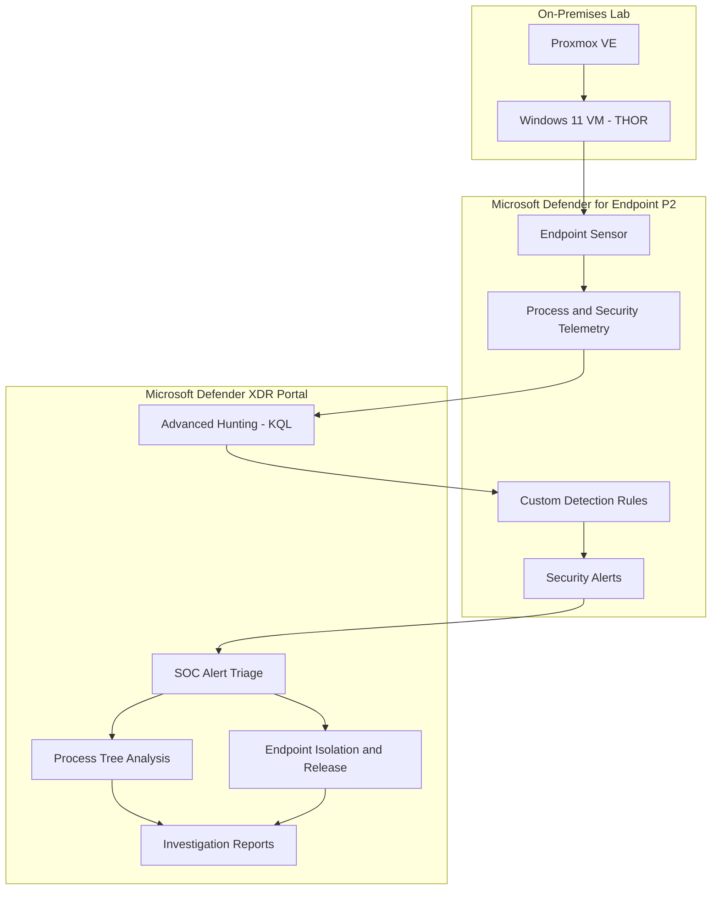
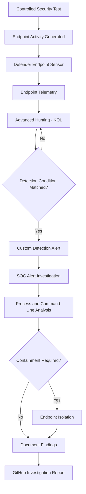

# Microsoft Defender EDR & XDR Security Operations Lab

**Microsoft Defender for Endpoint | Microsoft Defender XDR | KQL | Detection Engineering | Incident Response**

A hands-on cybersecurity project demonstrating endpoint threat detection, security alert investigation, advanced hunting, and incident response using Microsoft Defender for Endpoint P2.

The lab uses a Windows 11 endpoint named Thor, hosted on Proxmox VE, and integrated with Microsoft Defender for Endpoint. Controlled security scenarios are used to generate endpoint telemetry, validate custom detection rules, and investigate suspicious activity.

**Project Status:**
- Phase 1 - EDR: Five investigations performed; documentation in progress.
- Phase 2 - XDR: In progress.

---

## Project Objectives

- Deploy Microsoft Defender for Endpoint P2.
- Onboard a Windows 11 endpoint for security monitoring.
- Investigate endpoint alerts and suspicious processes.
- Develop and validate custom detection rules.
- Perform threat hunting using Kusto Query Language (KQL).
- Analyse PowerShell execution, malware detection, and persistence techniques.
- Practise endpoint isolation and recovery.
- Map relevant detections to MITRE ATT&CK.
- Document investigation findings with supporting evidence.
- Extend endpoint monitoring into XDR email-security investigations.

---

## Lab Architecture



### Technology Stack

| Technology | Purpose |
|---|---|
| Proxmox VE | Hosts the Windows 11 virtual machine |
| Windows 11 – Thor | Monitored endpoint |
| Microsoft Defender for Endpoint P2 | Endpoint detection and response |
| Microsoft Defender XDR | Security monitoring and investigation portal |
| Advanced Hunting | Endpoint telemetry investigation |
| Kusto Query Language | Threat hunting and detection queries |
| Custom Detection Rules | Detect suspicious endpoint behaviour |
| Process Tree Analysis | Investigate process execution relationships |
| Device Action Center | Review response actions |
| MITRE ATT&CK | Threat technique classification |

---

## SOC Investigation Workflow



The workflow represents the investigation process practised in the lab. Endpoint isolation was tested separately as an incident response exercise and was not required for every detection.

---

## Implementation

### 1. Windows 11 Endpoint

Deployed a Windows 11 virtual machine named **Thor** using Proxmox VE.

The endpoint was used to simulate suspicious processes, malware detection, scheduled task creation, and other controlled security activities.

### 2. Microsoft Defender for Endpoint P2

Configured Microsoft Defender for Endpoint P2 and onboarded Thor for endpoint monitoring.

Validated that the device appeared in the Microsoft Defender security portal and generated endpoint telemetry.

### 3. Advanced Hunting

Used Advanced Hunting to investigate endpoint activity using KQL.

Relevant telemetry included process execution events, command-line arguments, initiating processes, and security detection information.

### 4. Custom Detection Rules

Configured custom detection rules to identify suspicious endpoint activity.

The lab included detections for encoded PowerShell execution, suspicious scheduled task creation, and PowerShell launching Command Prompt.

### 5. Incident Response

Practised endpoint isolation and release through Microsoft Defender for Endpoint.

This exercise focused on understanding endpoint containment and restoring connectivity after investigation.

---

## EDR Investigations

Five controlled endpoint security investigations were performed.

| # | Investigation | Result |
|---|---|---|
| 01 | [Encoded PowerShell Execution](EDR/EDR-001-Encoded-PowerShell/README.md) | Detected |
| 02 | [EICAR Malware Detection](EDR/EDR-002-EICAR-Malware/README.md) | Prevented |
| 03 | [Suspicious Scheduled Task Creation](EDR/EDR-003-Scheduled-Task-Persistence/README.md) | Detected |
| 04 | [PowerShell Launched CMD](EDR/EDR-004-Suspicious-Process-Execution/README.md) | Investigated |
| 05 | [Endpoint Isolation and Release](EDR/EDR-005-Endpoint-Isolation/README.md) | Tested |

*Individual investigation reports and supporting screenshots are being uploaded.*

---

### 01 - Encoded PowerShell Execution

**MITRE ATT&CK:** `T1059.001 – PowerShell`

**Detection Type:** Custom Detection Rule

**Severity:** Low

Executed a controlled PowerShell command using the `-EncodedCommand` parameter to simulate suspicious script execution.

Microsoft Defender for Endpoint recorded the process activity and generated a custom detection alert.

The investigation included:

- Reviewing the generated security alert.
- Examining the PowerShell process execution chain.
- Analysing command-line arguments.
- Reviewing process metadata.
- Validating the custom detection rule.
- Investigating endpoint telemetry using Advanced Hunting.

**Detection Evidence:**

| Field | Finding |
|---|---|
| Endpoint | Thor |
| Process | powershell.exe |
| Suspicious Parameter | -EncodedCommand |
| Detection | Encoded PowerShell Execution Detected |
| Severity | Low |
| MITRE ATT&CK | T1059.001 |
| Detection Source | Custom Detection Rule |

**Advanced Hunting Query:**

```kusto
DeviceProcessEvents
| where Timestamp > ago(30d)
| where DeviceName =~ "thor"
| where FileName =~ "powershell.exe"
| where ProcessCommandLine contains "-EncodedCommand"
| project
    Timestamp,
    DeviceName,
    AccountName,
    FileName,
    ProcessCommandLine,
    InitiatingProcessFileName,
    ProcessId
| order by Timestamp desc
```

**Finding:**

Microsoft Defender successfully identified the controlled encoded PowerShell execution and generated a low-severity alert.

The presence of `-EncodedCommand` is a suspicious indicator requiring investigation, but it does not independently establish malicious activity.

**Verdict:** True Positive – Controlled Security Test

[View Full Investigation](EDR/EDR-001-Encoded-PowerShell/README.md)

---

### 02 - EICAR Malware Detection

Used the harmless EICAR antivirus test file to validate Microsoft Defender malware detection and prevention.

Microsoft Defender identified the test file and generated a malware prevention alert.

The investigation focused on:

- Malware detection.
- Security alert analysis.
- Endpoint protection behaviour.
- Detection and prevention evidence.

**Verdict:** True Positive – Controlled Antivirus Test

[View Full Investigation](EDR/EDR-002-EICAR-Malware/README.md)

---

### 03 - Suspicious Scheduled Task Creation

**MITRE ATT&CK:** `T1053.005 – Scheduled Task`

Created a controlled scheduled task to simulate a Windows persistence technique.

A custom detection rule identified suspicious scheduled task creation.

The investigation focused on:

- Scheduled task creation activity.
- Endpoint telemetry.
- Custom detection validation.
- Persistence technique analysis.

**Verdict:** True Positive – Controlled Security Test

[View Full Investigation](EDR/EDR-003-Scheduled-Task-Persistence/README.md)

---

### 04 - Suspicious Process Execution

**MITRE ATT&CK:** `T1059 – Command and Scripting Interpreter`

Investigated PowerShell launching `cmd.exe` on the Windows 11 endpoint.

The exercise focused on identifying suspicious parent-child process relationships and understanding how endpoint telemetry supports process investigations.

A custom detection rule was configured for the activity.

The investigation included:

- PowerShell process analysis.
- Command Prompt execution.
- Parent-child process relationships.
- Custom detection rule review.

**Verdict:** Controlled Security Test – Investigation Performed

[View Full Investigation](EDR/EDR-004-Suspicious-Process-Execution/README.md)

---

### 05 - Endpoint Isolation and Release

Practised endpoint containment and recovery using Microsoft Defender for Endpoint.

The Windows 11 lab device was isolated and subsequently released from isolation.

The exercise focused on:

- Endpoint containment.
- Device isolation.
- Incident response actions.
- Restoring endpoint connectivity.
- Reviewing response activity.

**Result:** Endpoint Isolation and Release Tested

[View Full Investigation](EDR/EDR-005-Endpoint-Isolation/README.md)

---

## MITRE ATT&CK Mapping

| Investigation | Technique ID | Technique |
|---|---|---|
| Encoded PowerShell Execution | T1059.001 | PowerShell |
| Suspicious Scheduled Task Creation | T1053.005 | Scheduled Task |
| PowerShell Launched CMD | T1059 | Command and Scripting Interpreter |

The EICAR investigation focused on antivirus detection rather than demonstrating a specific adversary technique.

Endpoint isolation and release were defensive response activities rather than adversary techniques.

---

## Challenges & Troubleshooting

### Custom Detection Validation

Creating a custom detection rule is not sufficient to confirm that the detection works.

The rule must be enabled, matching telemetry must be available, and alert generation must be verified.

### Process Investigation

Suspicious command-line arguments must be investigated alongside process ancestry, execution context, and supporting telemetry.

An encoded PowerShell command does not automatically mean an endpoint has been compromised.

### Endpoint Response

Endpoint isolation affects device connectivity and should be performed carefully.

The lab provided an opportunity to practise both containment and recovery in a controlled environment.

---

## Project Results

| Metric | Result |
|---|---|
| Monitored Windows Endpoints | 1 |
| EDR Investigations Performed | 5 |
| EDR Platform | Microsoft Defender for Endpoint P2 |
| Security Investigation Portal | Microsoft Defender XDR |
| Threat Hunting Language | KQL |
| Custom Detection Rules | Configured and tested |
| Process Investigation | Performed |
| Endpoint Isolation and Release | Tested |
| GitHub Investigation Documentation | In Progress |

---

## Phase 2 – XDR Investigations

**Status: Work in Progress**

The second phase extends the lab into email security and cross-domain investigations using Microsoft Defender for Office 365 and Microsoft Defender XDR.

The lab includes Exchange Online and Defender for Office 365 configuration.

| # | Investigation | Status |
|---|---|---|
| 01 | Phishing Email Detection and Quarantine | Tested – documentation pending |
| 02 | Credential Harvesting Simulation | In Progress |
| 03 | Malicious Email Attachment Detection | Planned |
| 04 | Suspicious URL and Safe Links Investigation | Planned |
| 05 | Email-to-Endpoint Correlation | Planned |

### XDR-001 – Phishing Email Detection

Sent a simulated phishing email to a controlled lab mailbox.

Microsoft Defender classified the email as phishing and quarantined it.

The investigation included reviewing the email threat verdict, detection technology, extracted URLs, and quarantine evidence.

A separate XDR security incident was not confirmed during this test.

### XDR-002 – Credential Harvesting Simulation

Configured Microsoft Defender Attack Simulation Training to simulate a credential-harvesting phishing scenario.

Simulation delivery and investigation evidence are still being validated.

### Planned XDR Investigations

The remaining investigations will focus on attachment detection, suspicious URLs, Safe Links, and cross-domain email-to-endpoint security analysis.

The XDR architecture and detailed investigation reports will be added after the relevant tests have been completed and validated.

---

## Key Findings

1. **Endpoint Visibility:** Microsoft Defender for Endpoint provides process and security telemetry for investigating suspicious endpoint activity.

2. **Detection Engineering:** Custom detection rules can identify suspicious behaviours when the required telemetry and detection conditions are present.

3. **Threat Hunting:** KQL helps analysts investigate process execution, command-line arguments, and endpoint activity.

4. **Investigation Context:** A detection alert should be analysed alongside process relationships and supporting evidence before reaching a conclusion.

5. **Incident Response:** Endpoint isolation and release provide practical experience with containment and recovery actions.

---

## Skills Demonstrated

- Microsoft Defender for Endpoint P2
- Endpoint Detection and Response
- Microsoft Defender XDR Portal
- Advanced Hunting with KQL
- Custom Detection Engineering
- Security Alert Triage
- Process Tree Analysis
- PowerShell Investigation
- Malware Detection and Prevention
- Windows Scheduled Task Analysis
- Endpoint Isolation and Recovery
- MITRE ATT&CK Mapping
- Security Investigation Documentation

---

## Conclusion

Implemented a Microsoft Defender for Endpoint lab using a Proxmox-hosted Windows 11 endpoint.

Performed five EDR investigations covering encoded PowerShell execution, malware prevention, scheduled task persistence, suspicious process execution, and endpoint containment.

The project demonstrates practical experience in endpoint security monitoring, custom detection engineering, threat hunting, alert investigation, and incident response.

The XDR phase is currently being developed to extend these capabilities into email security and cross-domain investigations.

---

## Ethical Use

All testing was performed within an authorised personal cybersecurity lab using controlled security simulations.

No production systems or third-party environments were targeted.

---

## Author

**Amal Varghese**

Cyber Security | SOC | Blue Team | Security Engineering

[LinkedIn](https://www.linkedin.com/in/amalbuilds/)

[GitHub Portfolio](https://github.com/CyberAmal)
