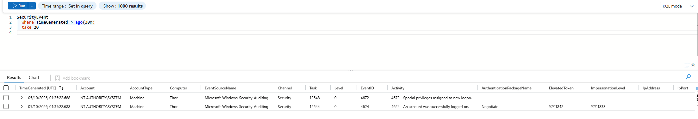
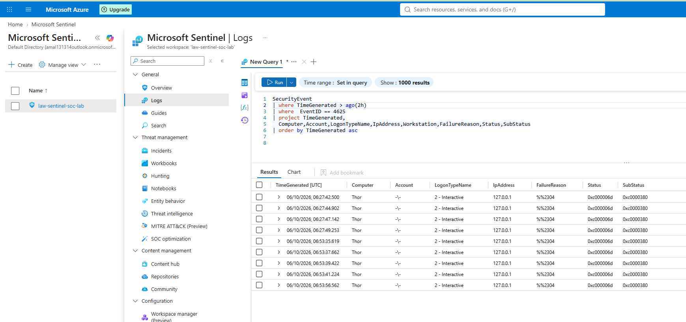

# Investigation 01 — Repeated Windows Failed Logons

## Overview

This investigation demonstrates the detection and analysis of repeated Windows authentication failures using **Microsoft Sentinel**.

Controlled failed authentication attempts were generated against a Windows 11 endpoint monitored through **Azure Arc** and **Azure Monitor Agent (AMA)**.

Windows Security Event ID **4625** captured the failed authentication attempts. KQL was used to investigate and correlate the activity, and a custom Microsoft Sentinel scheduled analytics rule generated an alert and incident when the configured threshold was reached.

---

## Investigation Objective

The objectives of this investigation were to:

- Generate controlled Windows authentication failures
- Verify Event ID 4625 ingestion into Microsoft Sentinel
- Analyse failed authentication events using KQL
- Correlate repeated authentication failures
- Develop a custom Sentinel Analytics Rule
- Generate and investigate a security incident
- Review related successful and failed authentication activity
- Map the observed behaviour to MITRE ATT&CK
- Document an analyst verdict

---

## Detection Logic

The detection monitors Windows Security Event ID:

**4625 — An account failed to log on**

The custom Sentinel scheduled analytics rule identifies:

> **Five or more failed authentication events associated with the same account and endpoint within a 10-minute period.**

### Detection Query

```kusto
SecurityEvent
| where EventID == 4625
| summarize
    FailedLogons = count(),
    FirstAttempt = min(TimeGenerated),
    LastAttempt = max(TimeGenerated)
    by Account, Computer
| where FailedLogons >= 5
```

**Rule severity:** Medium  
**Query frequency:** 5 minutes  
**Lookup period:** 10 minutes

---

## Investigation

### 1. Failed Authentication Analysis

Controlled failed authentication attempts were generated against the monitored Windows 11 endpoint.

The following KQL query was used to identify the resulting Event ID 4625 telemetry:

```kusto
SecurityEvent
| where TimeGenerated > ago(1h)
| where EventID == 4625
| project
    TimeGenerated,
    Computer,
    Account,
    LogonTypeName,
    IpAddress,
    WorkstationName,
    FailureReason
| order by TimeGenerated asc
```

The query confirmed that Windows authentication failures were successfully collected and available for investigation.


---

### 2. Detection and Incident Generation

The controlled activity produced at least five failed authentication events within the configured 10-minute detection window.

The custom scheduled analytics rule correlated the events and generated the **Repeated Windows Failed Logons** security alert and incident.

The incident was surfaced through the Microsoft Defender portal for analyst investigation.



This validated the detection path:

**Windows Event → AMA → Log Analytics → Microsoft Sentinel → Analytics Rule → Alert → Incident**

---

### 3. Authentication Timeline Analysis

Failed and successful Windows authentication events were correlated to provide additional context around the activity.

The following query was used:

```kusto
SecurityEvent
| where TimeGenerated > ago(2h)
| where EventID in (4624, 4625)
| project
    TimeGenerated,
    EventID,
    Activity,
    Account,
    Computer,
    LogonTypeName,
    IpAddress
| order by TimeGenerated asc
```

This allowed Event ID **4625** failed authentication activity to be reviewed alongside Event ID **4624** successful authentication activity.



---

## Event Analysis

| Event ID | Description | Investigation Relevance |
|---|---|---|
| **4625** | An account failed to log on | Primary detection event |
| **4624** | An account was successfully logged on | Used for authentication timeline correlation |

The repeated Event ID 4625 activity matched the controlled authentication test performed during the investigation.

---

## MITRE ATT&CK Mapping

### T1110 — Brute Force

Repeated authentication attempts are associated with the MITRE ATT&CK **Brute Force** technique.

The activity in this investigation was intentionally generated within the authorised lab environment to validate detection logic. It does not represent an actual brute-force compromise.

---

## Findings

- Windows failed authentication events were successfully collected as Event ID 4625.
- Azure Monitor Agent successfully forwarded endpoint security telemetry.
- KQL provided visibility into authentication activity.
- Multiple failed authentication events could be correlated by account and endpoint.
- The custom Sentinel Analytics Rule detected the configured threshold.
- Microsoft Sentinel successfully generated an alert and incident.
- Authentication events were correlated to provide additional investigation context.
- The observed activity matched the controlled security test.
- No evidence of unauthorised access or compromise was identified.

---

## Analyst Verdict

**Classification:** True Positive — Controlled Security Test

**Severity:** Medium

**MITRE ATT&CK:** T1110 — Brute Force

**Impact:** No compromise identified.

**Conclusion:** The detection successfully identified the controlled repeated authentication failures and generated an actionable security incident. The end-to-end detection and investigation workflow operated as expected.

---

## Skills Demonstrated

- Microsoft Sentinel
- KQL
- Windows Security Event analysis
- Authentication log analysis
- Detection engineering
- Scheduled Analytics Rules
- Alert triage
- Incident investigation
- Event correlation
- MITRE ATT&CK mapping
- SOC investigation documentation
