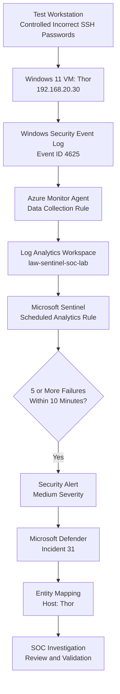
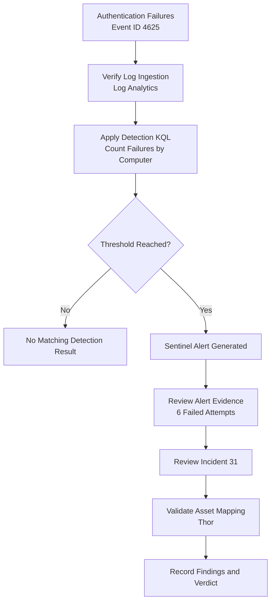

# Investigation 01 — Repeated Windows Failed Logons


## 1. Overview

This investigation demonstrates the detection and analysis of repeated Windows authentication failures using Microsoft Sentinel.

A controlled authentication test was performed against a Windows 11 virtual machine named **Thor**, hosted in a Proxmox environment and connected to Microsoft Azure through Azure Arc.

Windows Security Event ID **4625** was collected through Azure Monitor Agent (AMA), forwarded to a Log Analytics workspace, and analysed using a custom Microsoft Sentinel scheduled analytics rule.

The rule successfully generated a Medium-severity security alert, which was associated with Microsoft Defender Incident **31 — Repeated Windows Failed Logons**.

### Investigation Summary

| Attribute | Details |
|---|---|
| Investigation | 01 — Repeated Windows Failed Logons |
| Platform | Microsoft Sentinel |
| Endpoint | Thor |
| Operating System | Windows 11 |
| Endpoint IP | 192.168.20.30 |
| Infrastructure | Proxmox VE + Azure Arc |
| Log Source | Windows Security Events |
| Log Analytics Table | `Event` |
| Event ID | 4625 |
| Detection Type | Scheduled analytics rule |
| Severity | Medium |
| Detection Threshold | 5 or more failed logons within 10 minutes |
| Observed Test Activity | 6 failed logons |
| Incident | ID 31 — Repeated Windows Failed Logons |
| MITRE ATT&CK | T1110 — Brute Force |
| Validation | Alert and incident confirmed |

---

## 2. Objective

The objective was to build and validate a detection capable of identifying repeated Windows authentication failures.

The investigation focused on:

- Generating controlled failed authentication events.
- Collecting Windows Security logs from an Azure Arc-enabled endpoint.
- Writing a KQL detection query.
- Configuring a scheduled analytics rule in Microsoft Sentinel.
- Confirming security alert generation.
- Validating incident creation and endpoint entity mapping.
- Preserving investigation evidence for a SOC analyst portfolio.

---

## 3. Lab Architecture



The endpoint was hosted locally, while security monitoring and detection were performed through Microsoft Azure and Microsoft Sentinel.

---

## 4. Log Collection and Test Activity

### Test Scenario

A controlled series of incorrect SSH password attempts was performed against Thor to generate failed Windows authentication events.

The test produced **six Event ID 4625 records** within approximately seven seconds.

The events were successfully ingested into the Log Analytics workspace.

### Investigation Query

```kusto
Event
| where TimeGenerated > ago(1h)
| where EventID == 4625
| project TimeGenerated, Computer, EventID, RenderedDescription
| order by TimeGenerated desc
```

This query was used to inspect the collected authentication failures and confirm that the expected events were available for analysis.

### Evidence — Failed Authentication Events


**Observed findings:**

- Six failed authentication events were recorded.
- The affected endpoint was Thor.
- All six records used Windows Security Event ID 4625.
- The test activity was visible in the Log Analytics `Event` table.

---

## 5. Detection Engineering

A custom scheduled analytics rule was created in Microsoft Sentinel.

### Detection Rule

**Rule name:** Repeated Windows Failed Logons

### KQL Detection Logic

```kusto
Event
| where TimeGenerated > ago(10m)
| where EventID == 4625
| summarize FailedAttempts = count(),
            FirstAttempt = min(TimeGenerated),
            LastAttempt = max(TimeGenerated)
    by Computer
| where FailedAttempts >= 5
| project LastAttempt, Computer, FailedAttempts, FirstAttempt
```

### How the Detection Works

1. Searches the `Event` table for records from the previous 10 minutes.
2. Filters Windows Security Event ID 4625.
3. Groups failed logon events by computer.
4. Counts failed attempts and records the first and last timestamps.
5. Returns computers with at least five failed attempts.

**Important:** This rule aggregates events by `Computer`, not by username or source IP address. Therefore, it detects a concentration of failed logons on an endpoint but does not independently establish that all attempts targeted the same account or originated from one source.

### Analytics Rule Configuration

| Setting | Configuration |
|---|---|
| Rule Name | Repeated Windows Failed Logons |
| Rule Type | Scheduled |
| Query Frequency | Every 5 minutes |
| Lookup Period | Last 10 minutes |
| Trigger Condition | Number of query results greater than 0 |
| Failed Logon Threshold | 5 |
| Severity | Medium |
| Host Entity Type | Host |
| Host Identifier | HostName |
| Host Value | Computer |

### Evidence — Analytics Rule


The detection rule was validated using the generated authentication failures.

---

## 6. Alert Investigation

Microsoft Sentinel successfully generated a security alert from the scheduled analytics rule.

### Observed Alert Details

| Field | Observed Value |
|---|---|
| Alert Name | Repeated Windows Failed Logons |
| Severity | Medium |
| Endpoint | Thor |
| Failed Attempts | 6 |
| Detection Source | Scheduled detection |
| Service Source | Microsoft Sentinel |
| Category | Credential Access |
| Alert Generated | 12 October 2026, 02:05:06 AM (portal time) |

The alert's related events contained one aggregated result for Thor, showing six failed attempts and the first and last attempt timestamps.

### Evidence — Security Alert


This confirms that the analytics rule progressed beyond a successful KQL query and generated a security alert.

---

## 7. Incident Investigation

The generated alerts were associated with an incident in the Microsoft Defender incident management interface.

### Incident Details

| Field | Observed Value |
|---|---|
| Incident ID | 31 |
| Incident Name | Repeated Windows Failed Logons |
| Severity | Medium |
| Status | Active |
| Classification | Unclassified |
| Affected Asset | Thor |
| Alerts Displayed | 11 |
| Detection Source | Microsoft Sentinel |
| Detection Method | Scheduled detection |

Multiple alerts were displayed under the same incident.

### Evidence — Incident


The incident was visible in the incident queue with Thor listed as the impacted asset.

---

## 8. Entity Mapping Validation

The analytics rule was configured to map the query's `Computer` field to a Host entity:

**Host → HostName → Computer**

The incident's Assets section displayed Thor as an affected device.

### Evidence — Affected Device


This confirms that the detection was associated with the intended lab endpoint and that the device entity was available during incident investigation.

---

## 9. Investigation Workflow



---

## 10. MITRE ATT&CK Mapping

| Category | Mapping |
|---|---|
| Tactic | Credential Access |
| Technique | T1110 — Brute Force |
| Supporting Event | Windows Security Event ID 4625 |
| Detection Indicator | Repeated failed authentication attempts |
| Validation | Controlled lab simulation |

**Technique reference:** https://attack.mitre.org/techniques/T1110/

Repeated failed authentication attempts can be consistent with brute-force behaviour.

However, Event ID 4625 alone does not prove a malicious brute-force attack. In this investigation, the activity was deliberately generated for detection testing.

---

## 11. Findings

The investigation established the following:

1. The controlled authentication test generated six failed Windows logon events.
2. Windows Security Event ID 4625 was successfully collected from Thor.
3. The Log Analytics `Event` table contained the expected records.
4. The custom KQL rule detected the failures using a five-event threshold over a 10-minute window.
5. Microsoft Sentinel generated a Medium-severity security alert.
6. The alert was associated with an incident displayed as Incident 31.
7. The incident contained multiple related alerts and identified Thor as an affected device.

### Detection Limitations

The current detection groups authentication failures by endpoint only.

As a result, it cannot independently distinguish:

- Repeated attempts against a single user from attempts against multiple users.
- One attacking source from multiple independent sources.
- Malicious brute-force activity from legitimate authentication mistakes.

Further enrichment using account names, source IP addresses, and successful authentication events could improve detection accuracy and investigation context.

---

## 12. Analyst Verdict

**Classification:** Benign Positive — Authorized Security Test

**Detection Outcome:** Successful

The authentication failures were deliberately generated in an isolated lab environment to validate the monitoring pipeline and custom analytics rule.

The expected Windows Security events were ingested, the detection threshold was met, and a Microsoft Sentinel security alert was generated.

The related incident and Thor device entity were also confirmed in the incident management interface.

No unauthorized activity was established by the evidence collected for this test.

---

## 13. Skills Demonstrated

- Microsoft Sentinel detection engineering
- Kusto Query Language (KQL)
- Windows Security Event analysis
- Azure Arc-enabled server monitoring
- Azure Monitor Agent and Data Collection Rules
- Log Analytics investigation
- Scheduled analytics rule configuration
- Alert triage and incident investigation
- Entity mapping validation
- MITRE ATT&CK mapping
- Security investigation documentation

---

## 14. Evidence Index

| Screenshot | Description |
|---|---|
| `01-failed-logons-kql.png` | Event ID 4625 records in Log Analytics |
| `02-analytics-rule.png` | Scheduled analytics rule and detection configuration |
| `03-sentinel-alert.png` | Generated alert and six failed attempts |
| `04-sentinel-incident.png` | Incident 31 in the incident queue |
| `05-incident-assets.png` | Incident asset mapping showing Thor |

All screenshots were captured from the configured SOC lab environment.

---

## 15. Conclusion

This investigation demonstrates an end-to-end security detection workflow, from generating Windows authentication failures to collecting telemetry, applying a custom KQL detection rule, generating a Microsoft Sentinel alert, and validating the resulting incident.

The successful detection and entity mapping provide evidence of hands-on experience with cloud SIEM operations, Windows event monitoring, and SOC alert investigation.

**Investigation Status: Completed — Detection Validated**
