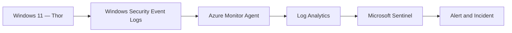
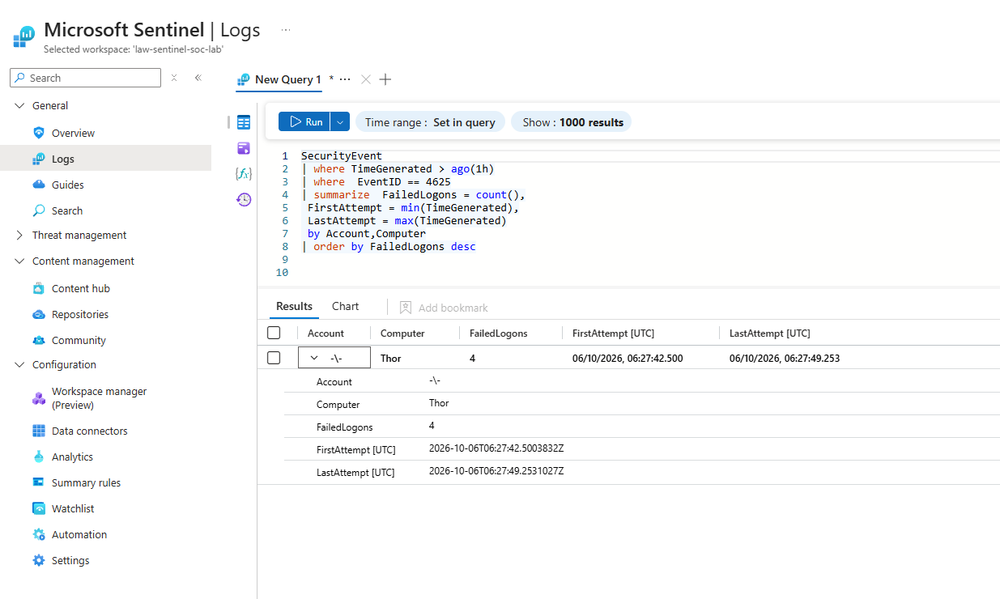
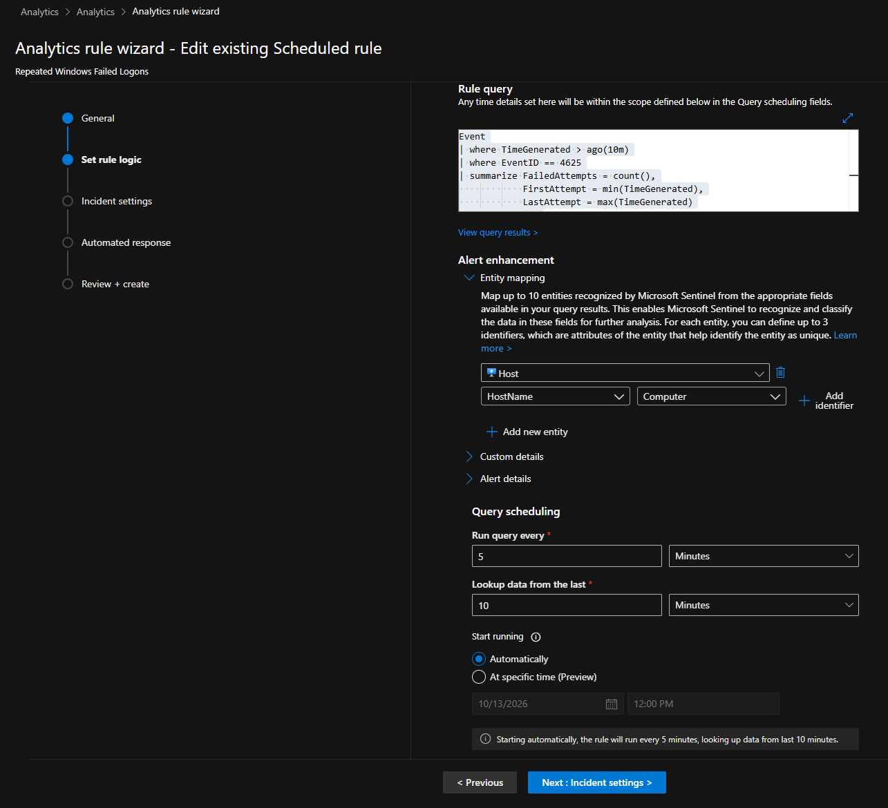
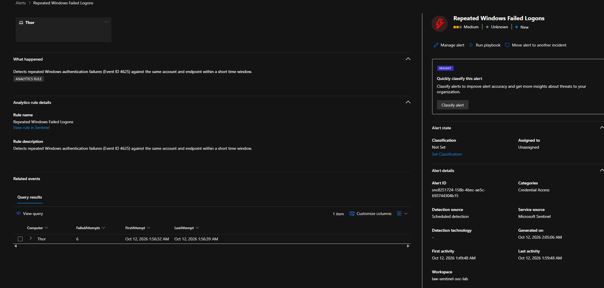
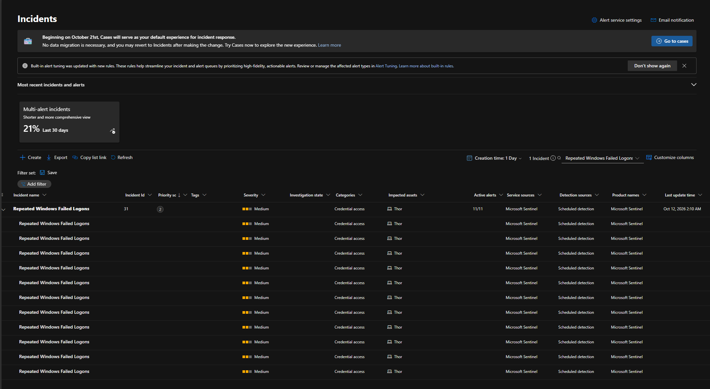
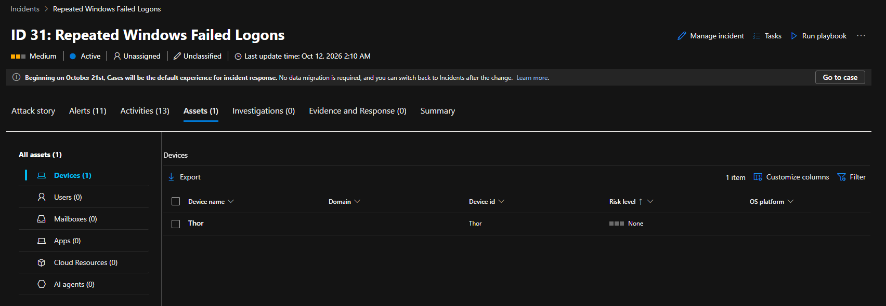
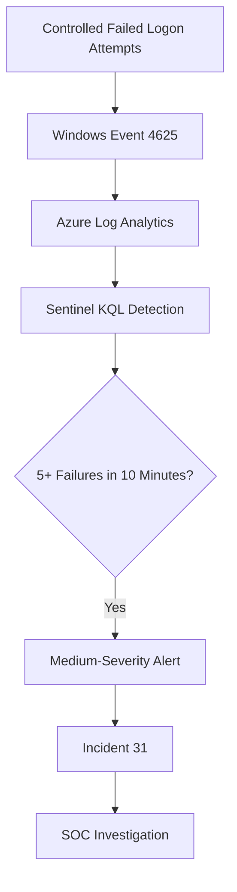

# Investigation 01 — Repeated Windows Failed Logons

**Project:** Microsoft Sentinel Cloud SOC & Threat Detection  
**Endpoint:** Thor (Windows 11)  
**Severity:** Medium  
**MITRE ATT&CK:** T1110 — Brute Force

## Overview

Investigated repeated Windows authentication failures using Microsoft Sentinel. A controlled test involving incorrect SSH passwords was performed against the Windows 11 endpoint `Thor`.

Windows Security Event 4625 was collected through Azure Monitor Agent and analysed using a scheduled Microsoft Sentinel detection rule.

## Lab Architecture



## 1. Windows Event Log Analysis

**Event ID:** 4625 - An account failed to log on.

**KQL investigation query:**

```kusto
Event
| where TimeGenerated > ago(1h)
| where EventID == 4625
| project TimeGenerated, Computer, EventID, RenderedDescription
| order by TimeGenerated desc
```

Six failed authentication events were recorded on `Thor` within approximately seven seconds.



## 2. Microsoft Sentinel Detection

**Analytics rule:** `Repeated Windows Failed Logons`

**KQL detection rule:**

```kusto
Event
| where TimeGenerated > ago(10m)
| where EventID == 4625
| summarize FailedAttempts = count(),
            FirstAttempt = min(TimeGenerated),
            LastAttempt = max(TimeGenerated)
    by Computer
| where FailedAttempts >= 5
| project LastAttempt, Computer, FailedAttempts, FirstAttempt
```

| Setting | Configuration |
|---|---|
| Rule type | Scheduled |
| Frequency | Every 5 minutes |
| Lookback | 10 minutes |
| Detection threshold | 5 or more failed logons |
| Alert trigger | Query results greater than 0 |
| Entity mapping | HostName → Computer |
| Severity | Medium |

The rule counts failures by endpoint, rather than by username or source IP.



## 3. Alert and Incident Investigation

Microsoft Sentinel generated a medium-severity security alert after detecting six failed authentication attempts.



**Selected incident:** 31

| Field | Finding |
|---|---|
| Severity | Medium |
| Status | Active |
| Classification | Unclassified |
| Associated alerts | 11 |
| Affected endpoint | Thor |
| Detection source | Microsoft Sentinel |



The incident's Assets tab confirmed `Thor` as the affected device.



## 4. Detection Workflow



## 5. MITRE ATT&CK Mapping

| Technique | ID | Relevance |
|---|---|---|
| Brute Force | T1110 | Repeated authentication failures can indicate password-guessing activity |

## 6. Findings and Outcome

- Confirmed collection of Windows Security Event 4625.
- Identified six failed authentication attempts on `Thor`.
- Validated the Microsoft Sentinel detection threshold.
- Confirmed medium-severity alert generation.
- Investigated Incident 31 and verified the affected endpoint.
- Confirmed the activity originated from an authorised lab simulation.

**Outcome:** Detection successfully validated. No confirmed malicious compromise.

## Skills Demonstrated

Windows Event Log Analysis · Microsoft Sentinel · KQL · Failed Logon Detection · Incident Triage · MITRE ATT&CK
