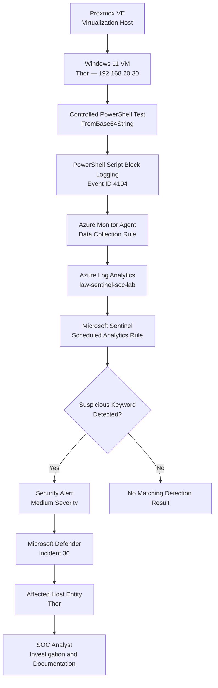
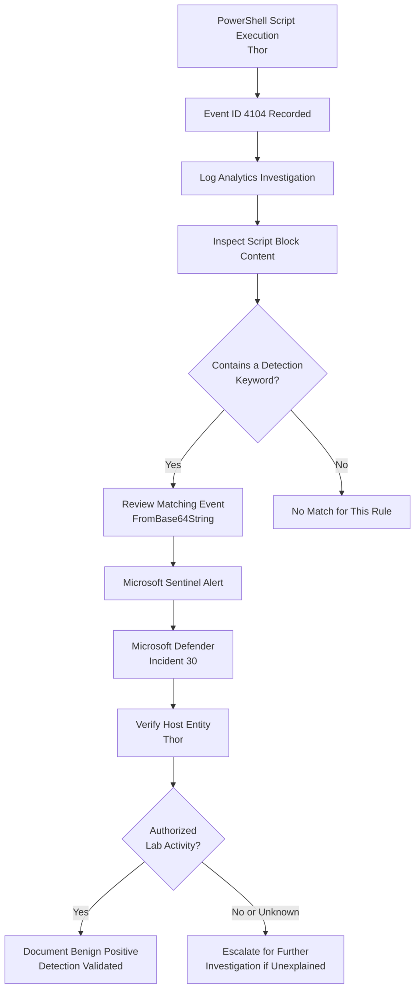

# Investigation 02 — Suspicious PowerShell Activity


## 1. Overview

This investigation demonstrates the detection and analysis of potentially suspicious PowerShell script execution using Microsoft Sentinel.

A controlled PowerShell test was performed on **Thor**, a Windows 11 virtual machine hosted in a Proxmox environment and connected to Microsoft Azure through Azure Arc.

The test involved PowerShell's `FromBase64String` method, which can be used to decode Base64-encoded content. This behaviour is not inherently malicious, but it can appear in scripts that attempt to obscure their functionality.

PowerShell Script Block Logging recorded the activity as **Windows Event ID 4104**. The event was forwarded through Azure Monitor Agent to Log Analytics and evaluated by a custom Microsoft Sentinel scheduled analytics rule.

The detection successfully generated a Medium-severity alert associated with **Incident 30 — SOC - Suspicious PowerShell Activity**.

### Investigation Summary

| Attribute | Details |
|---|---|
| Investigation | 02 — Suspicious PowerShell Activity |
| SIEM | Microsoft Sentinel |
| Endpoint | Thor |
| Operating System | Windows 11 |
| Endpoint IP | 192.168.20.30 |
| Infrastructure | Proxmox VE + Azure Arc |
| Log Source | PowerShell Script Block Logging |
| Log Analytics Table | `Event` |
| Event ID | 4104 |
| Detection Rule | SOC - Suspicious PowerShell Activity |
| Rule Type | Scheduled |
| Severity | Medium |
| Incident ID | 30 |
| Incident Status | Active |
| MITRE ATT&CK | T1059.001 — PowerShell |
| Investigation Outcome | Detection validated |

---

## 2. Investigation Objectives

The objectives of this investigation were to:

- Generate controlled PowerShell script execution activity.
- Verify that PowerShell Script Block Logging captured the test.
- Collect Event ID 4104 through Azure Monitor Agent.
- Detect selected suspicious PowerShell indicators using KQL.
- Validate scheduled analytics rule execution in Microsoft Sentinel.
- Confirm alert generation and incident association.
- Verify that the affected endpoint was mapped correctly.
- Document findings and limitations using real investigation evidence.

---

## 3. Lab Architecture

The investigation used a hybrid security monitoring environment combining local virtualization and Azure cloud security services.



### Infrastructure Components

| Component | Purpose |
|---|---|
| Proxmox VE | Hosts the Windows 11 test machine |
| Thor | Endpoint used for controlled PowerShell testing |
| Azure Arc | Connects the on-premises VM to Azure management |
| Azure Monitor Agent | Collects configured Windows event logs |
| Data Collection Rule | Defines the event collection pipeline |
| Log Analytics | Stores and supports querying collected events |
| Microsoft Sentinel | Executes detection logic and generates alerts |
| Microsoft Defender | Displays alerts, incidents and affected assets |

---

## 4. Test Scenario

### Scenario Description

A controlled PowerShell script was executed on Thor using the .NET method:

`[Convert]::FromBase64String(...)`

This method converts Base64-encoded data into bytes. It can be used legitimately, but it is also a technique that may appear in obfuscated PowerShell scripts.

The purpose of the test was to confirm whether PowerShell script block content containing this method could be collected and detected.

The test did not require downloading malicious files, executing malware, or establishing external command-and-control communication.

### Observed Activity

Log Analytics returned two matching PowerShell Script Block Logging records from Thor.

| Field | Observed Value |
|---|---|
| Computer | Thor |
| Event ID | 4104 |
| Matching Indicator | `FromBase64String` |
| Matching Records | 2 |
| Event Content | PowerShell script block text |
| Data Source | Log Analytics `Event` table |

The records demonstrated that the PowerShell commands were captured and available for security analysis.

---

## 5. Log Investigation

### KQL Investigation Query

The following query was used to locate PowerShell script blocks containing selected suspicious indicators.

```kusto
Event
| where EventID == 4104
| where RenderedDescription has_any (
    "EncodedCommand",
    "FromBase64String",
    "DownloadString",
    "Invoke-Expression",
    "IEX"
)
| project TimeGenerated, Computer, EventID, RenderedDescription
| order by TimeGenerated desc
```

### Query Explanation

The query:

1. Searches the `Event` table.
2. Filters for PowerShell Script Block Logging Event ID 4104.
3. Searches script block descriptions for selected PowerShell indicators.
4. Returns the event timestamp, endpoint, Event ID and script content.
5. Sorts the matching records by most recent timestamp.

### Evidence 01 — PowerShell Event Logs


**Findings:** Two matching Event ID 4104 records were visible for Thor. Both contained PowerShell script block content involving `FromBase64String`.

This confirmed that the relevant endpoint telemetry was reaching Log Analytics.

---

## 6. Detection Engineering

### Analytics Rule

**Rule name:** SOC - Suspicious PowerShell Activity

**Rule type:** Scheduled analytics rule

### Actual KQL Detection Query

```kusto
Event
| where EventID == 4104
| where RenderedDescription has_any (
    "EncodedCommand",
    "FromBase64String",
    "DownloadString",
    "Invoke-Expression",
    "IEX"
)
| project TimeGenerated, Computer, EventID, RenderedDescription
```

The saved analytics rule evaluates PowerShell script block events against a list of keywords associated with potentially suspicious command execution.

### Detection Indicators

| Indicator | Detection Relevance |
|---|---|
| `EncodedCommand` | PowerShell command-line encoding |
| `FromBase64String` | Base64 decoding within scripts |
| `DownloadString` | Retrieving content from a URL |
| `Invoke-Expression` | Evaluating a string as PowerShell code |
| `IEX` | Alias associated with `Invoke-Expression` |

These indicators are useful for identifying activity worth investigating. Their presence alone does not establish malicious intent.

### Verified Rule Configuration

| Setting | Configuration |
|---|---|
| Rule Name | SOC - Suspicious PowerShell Activity |
| Event ID | 4104 |
| Query Frequency | Every 5 minutes |
| Lookup Period | Last 5 minutes |
| Start Running | Automatically |
| Host Entity Type | Host |
| Host Identifier | HostName |
| Host Field | Computer |
| Alert Severity | Medium |

The alert trigger threshold was not visible in the captured rule configuration screenshot, so no specific threshold value is asserted here.

### Evidence 02 — Analytics Rule Configuration


The screenshot shows the configured query, scheduled execution settings and Host entity mapping.

---

## 7. Security Alert Investigation

Microsoft Sentinel generated a security alert from the configured analytics rule.

### Verified Alert Details

| Field | Observed Value |
|---|---|
| Alert Name | SOC - Suspicious PowerShell Activity |
| Severity | Medium |
| Affected Device | Thor |
| Event ID | 4104 |
| Detection Source | Scheduled detection |
| Service Source | Microsoft Sentinel |
| Category | Execution |
| Matching Script Content | `FromBase64String` |
| Incident Association | Confirmed |

The alert details included a related event containing the PowerShell script block text.

The expanded event record confirmed the affected computer and the matching indicator.

### Evidence 03 — Generated Security Alert


**Finding:** The alert was generated by the custom analytics rule, demonstrating that the detection operated beyond a manual Log Analytics query.

---

## 8. Incident Investigation

The PowerShell alert was associated with an incident in the Microsoft Defender incident management interface.

### Incident Details

| Field | Observed Value |
|---|---|
| Incident ID | 30 |
| Incident Name | SOC - Suspicious PowerShell Activity |
| Severity | Medium |
| Status | Active |
| Classification | Unclassified |
| Assignment | Unassigned |
| Alerts | 1 |
| Activities | 1 |
| Affected Device | Thor |
| Creation Time | 11 October 2026, 7:45:28 PM (portal time) |

The incident's Attack story displayed the PowerShell alert and linked it to Thor.

### Evidence 04 — Incident Overview


The screenshot demonstrates successful alert-to-incident association and provides the context needed for SOC triage.

---

## 9. Entity Mapping Validation

The scheduled analytics rule was configured with the following entity mapping:

**Host → HostName → Computer**

This configuration allows Microsoft Sentinel to associate the detected event with the relevant endpoint.

The incident's Assets tab identified Thor as the affected device.

### Evidence 05 — Incident Assets


### Observed Asset Details

| Field | Value |
|---|---|
| Device Name | Thor |
| Device ID | Thor |
| Device Count | 1 |
| Displayed Risk Level | None |

The Assets view confirmed that Thor was successfully associated with Incident 30.

The displayed risk level is a portal attribute and should not be interpreted as proof that the endpoint is free from security threats.

---

## 10. SOC Investigation Workflow



This workflow illustrates the detection and triage process used to evaluate the PowerShell activity.

---

## 11. MITRE ATT&CK Mapping

| Category | Mapping |
|---|---|
| Tactic | Execution |
| Technique | T1059 — Command and Scripting Interpreter |
| Sub-technique | T1059.001 — PowerShell |
| Supporting Telemetry | PowerShell Event ID 4104 |
| Observed Indicator | `FromBase64String` |
| Validation | Authorized PowerShell lab test |

**Reference:** https://attack.mitre.org/techniques/T1059/001/

PowerShell is a legitimate administration tool that can also be used by threat actors to execute commands and scripts.

This investigation demonstrates detection of PowerShell activity associated with that technique. It does not demonstrate a confirmed malicious attack.

---

## 12. Investigation Findings

The investigation established the following:

1. PowerShell script block activity was successfully recorded on Thor.
2. Two matching Event ID 4104 records were visible in Log Analytics.
3. The script block content included the `FromBase64String` method.
4. The custom Microsoft Sentinel analytics rule detected the selected indicator.
5. A Medium-severity security alert was generated.
6. The alert was associated with Incident 30.
7. The incident contained one alert and identified Thor as the affected device.
8. The Host entity mapping was successfully reflected in the incident Assets view.

### Detection Limitations

The current rule uses keyword matching against script block text.

Consequently, it may:

- Generate alerts for legitimate PowerShell administration or scripting.
- Miss suspicious commands that do not contain the configured keywords.
- Require additional context to determine whether script execution is malicious.
- Provide limited information about user intent, parent processes or network activity without further telemetry.

### Potential Improvements

Future enhancements could include:

- Correlating PowerShell events with process creation telemetry.
- Examining user accounts and parent process information.
- Adding allowlisting for approved administrative scripts.
- Investigating decoded command content when relevant.
- Correlating suspicious PowerShell activity with network connections.
- Improving detection logic to reduce false positives.

These are proposed enhancements, not controls claimed to have been implemented during this investigation.

---

## 13. Analyst Verdict

**Classification:** Benign Positive — Authorized Security Test

**Detection Result:** Successful

The PowerShell activity was deliberately generated as part of a controlled SOC lab exercise.

The command used a legitimate Base64-decoding method to test whether the monitoring pipeline could capture and detect potentially suspicious PowerShell script content.

The expected Event ID 4104 records were collected, the custom Microsoft Sentinel analytics rule generated an alert, and the associated incident correctly identified Thor.

The observed activity was consistent with the authorized test. The collected evidence does not establish malicious execution, malware infection or unauthorized access.

The incident remained **Active** and **Unclassified** in the captured portal evidence; the analyst verdict above is the lab investigation assessment rather than a claim that the portal incident was formally closed or classified.

---

## 14. Skills Demonstrated

- Microsoft Sentinel SIEM operations
- PowerShell Script Block Logging
- Windows Event ID 4104 analysis
- Kusto Query Language (KQL)
- Azure Monitor Agent and Data Collection Rules
- Azure Arc-enabled endpoint monitoring
- Log Analytics investigation
- Scheduled analytics rule configuration
- Suspicious command detection
- Security alert triage
- Incident investigation
- Host entity mapping
- MITRE ATT&CK technique mapping
- Evidence-based SOC documentation

---

## 15. Evidence Index

| Screenshot | Evidence |
|---|---|
| `01-powershell-logs.png` | PowerShell Event ID 4104 records in Log Analytics |
| `02-analytics-rule.png` | Scheduled analytics rule, KQL and entity mapping |
| `03-sentinel-alert.png` | Generated security alert and related script block |
| `04-sentinel-incident.png` | Incident 30 overview and attack story |
| `05-incident-assets.png` | Incident Assets tab identifying Thor |

All screenshots were collected from the configured SOC lab environment.

---

## 16. Conclusion

This investigation demonstrates an end-to-end PowerShell security monitoring workflow using Microsoft Sentinel.

The exercise validated the collection of PowerShell Script Block Logging events, detection of selected suspicious script indicators, security alert generation, incident association and endpoint entity mapping.

The results provide practical evidence of hands-on experience with cloud SIEM detection engineering, Windows endpoint telemetry, PowerShell security analysis and SOC incident investigation.

**Investigation Status: Completed — Detection Validated**
