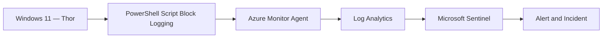
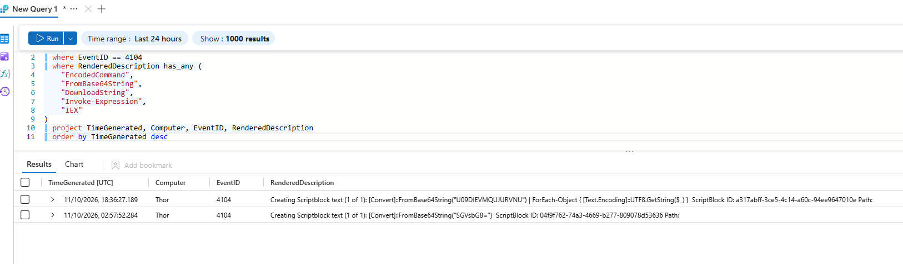
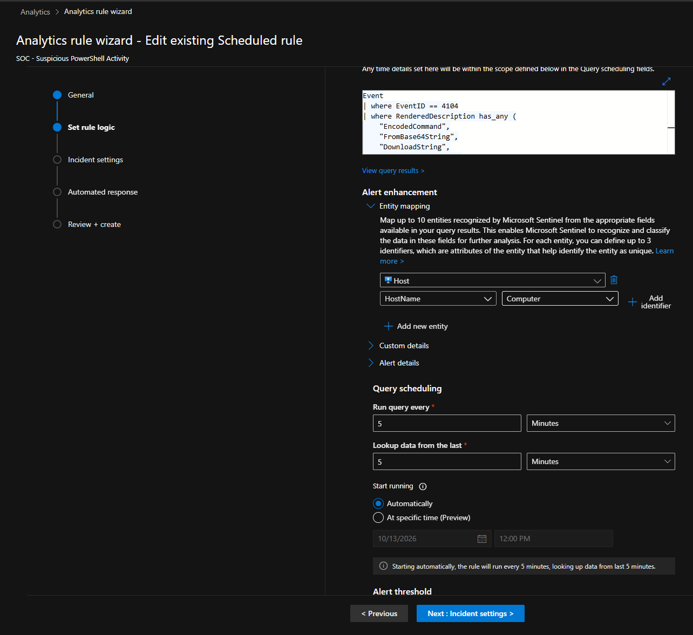
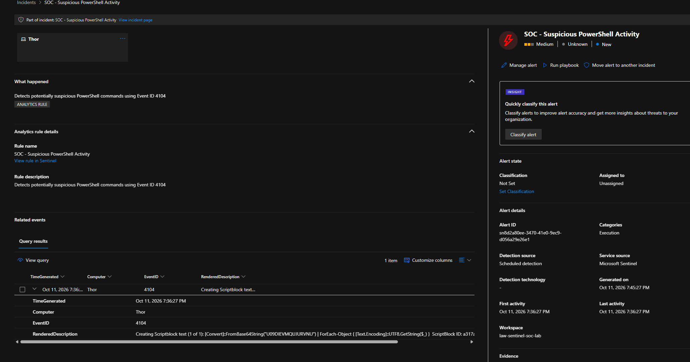
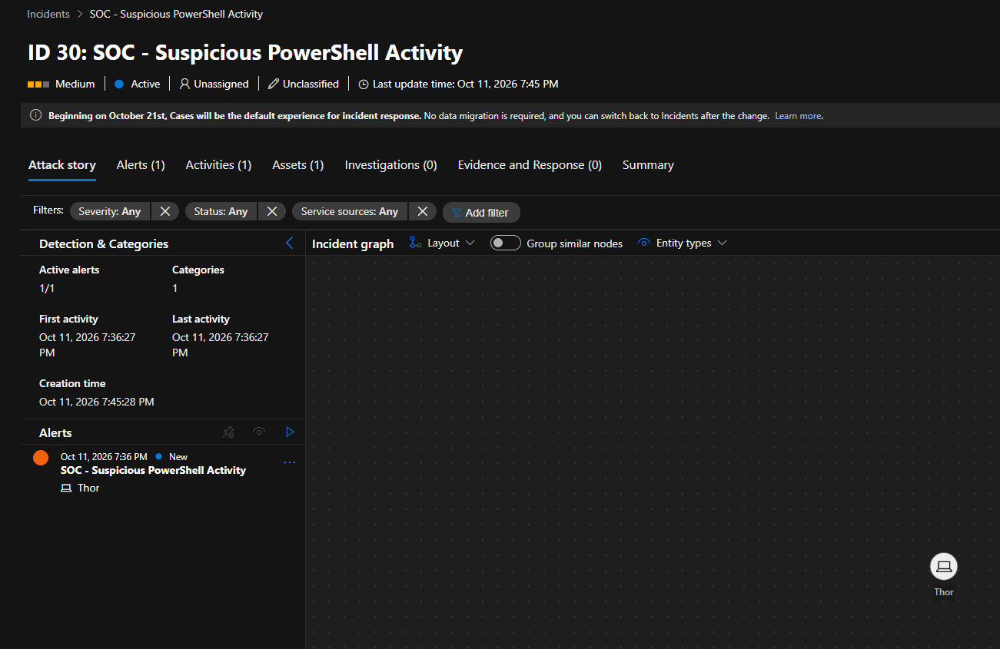
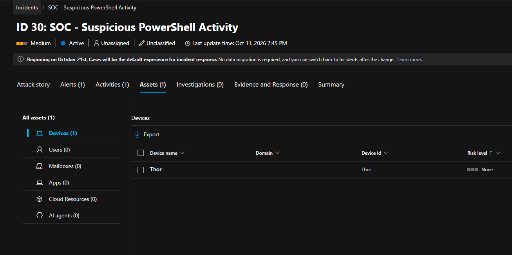
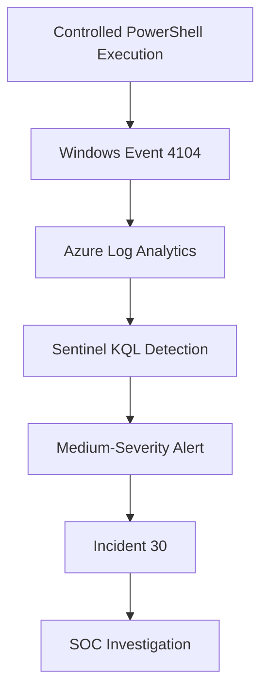

# Investigation 02 — Suspicious PowerShell Activity

**Project:** Microsoft Sentinel Cloud SOC & Threat Detection  
**Endpoint:** Thor (Windows 11)  
**Severity:** Medium  
**MITRE ATT&CK:** T1059.001 — PowerShell

## Overview

Investigated suspicious PowerShell activity using Microsoft Sentinel. A controlled PowerShell test involving `FromBase64String` was performed on the Windows 11 endpoint `Thor`.

PowerShell Script Block Logging generated Event ID 4104, which was collected in Azure Log Analytics and detected by a scheduled Microsoft Sentinel analytics rule.

## Lab Architecture



## 1. Windows Event Log Analysis

**Event ID:** 4104 — PowerShell Script Block Logging

**KQL investigation query:**

```kusto
Event
| where EventID == 4104
| where RenderedDescription has_any (
    "EncodedCommand",
    "FromBase64String",
    "DownloadString",
    "Invoke-Expression",
    "IEX"
)
| project TimeGenerated, Computer, EventID, RenderedDescription
| order by TimeGenerated desc
```

Two matching events were identified on `Thor`, containing the PowerShell `FromBase64String` method.



## 2. Microsoft Sentinel Detection

**Analytics rule:** `SOC - Suspicious PowerShell Activity`

**KQL detection rule:**

```kusto
Event
| where EventID == 4104
| where RenderedDescription has_any (
    "EncodedCommand",
    "FromBase64String",
    "DownloadString",
    "Invoke-Expression",
    "IEX"
)
| project TimeGenerated, Computer, EventID, RenderedDescription
```

| Setting | Configuration |
|---|---|
| Rule type | Scheduled |
| Frequency | Every 5 minutes |
| Lookback | 5 minutes |
| Entity mapping | HostName → Computer |
| Incident severity | Medium |



## 3. Alert and Incident Investigation

Microsoft Sentinel generated a medium-severity security alert associated with **Incident 30**.



**Selected incident:** 30

| Field | Finding |
|---|---|
| Severity | Medium |
| Status | Active |
| Classification | Unclassified |
| Associated alerts | 1 |
| Affected endpoint | Thor |
| Detection source | Microsoft Sentinel |



The incident's Assets tab confirmed `Thor` as the affected device.



## 4. Detection Workflow



## 5. MITRE ATT&CK Mapping

| Technique | ID | Relevance |
|---|---|---|
| Command and Scripting Interpreter: PowerShell | T1059.001 | PowerShell script execution and analysis |

## 6. Findings and Outcome

- Confirmed collection of PowerShell Event ID 4104.
- Identified two matching script block events containing `FromBase64String`.
- Validated the Microsoft Sentinel scheduled analytics rule.
- Confirmed medium-severity alert generation.
- Investigated Incident 30 and verified the affected endpoint.
- Confirmed the activity originated from an authorised lab simulation.

**Outcome:** Detection successfully validated. No confirmed malicious compromise.

## Skills Demonstrated

PowerShell Script Block Logging · Microsoft Sentinel · KQL · Windows Event Analysis · Suspicious Script Detection · Incident Triage · MITRE ATT&CK
