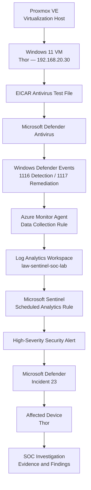
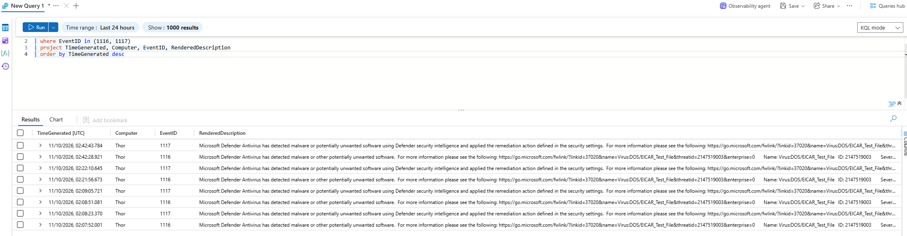
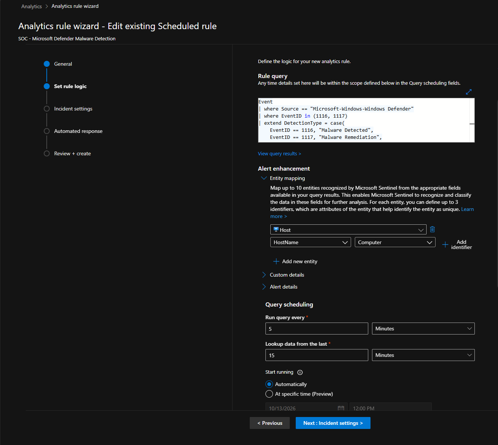
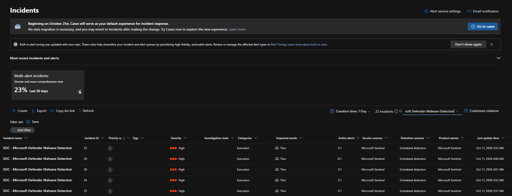
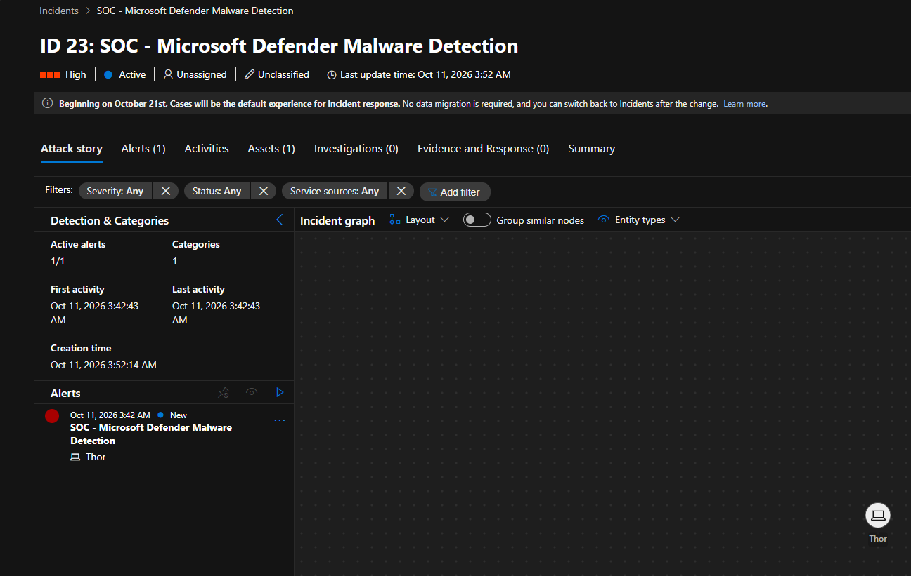
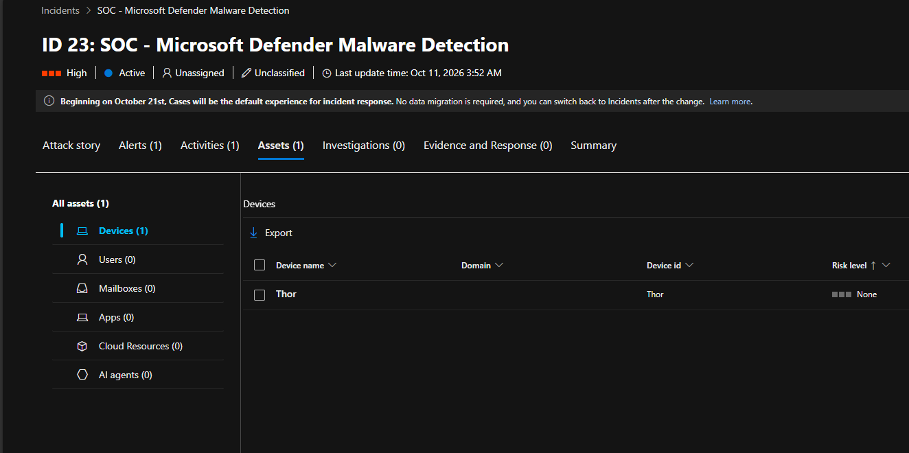
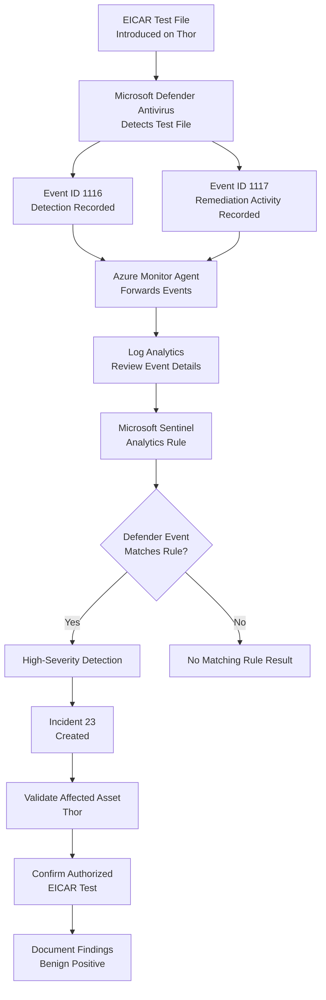

# Investigation 03 — Microsoft Defender Malware Detection


## 1. Overview

This investigation demonstrates the detection and analysis of Microsoft Defender Antivirus malware-related events using Microsoft Sentinel.

A controlled malware-detection test was conducted on **Thor**, a Windows 11 virtual machine hosted on Proxmox VE and connected to Microsoft Azure through Azure Arc.

The test used the **EICAR antivirus test file**, a harmless file designed to trigger antivirus detection without introducing real malware.

Microsoft Defender Antivirus generated Windows Event IDs **1116** and **1117**, recording malware detection and remediation activity. These events were collected through Azure Monitor Agent, ingested into Log Analytics, and evaluated using a custom Microsoft Sentinel scheduled analytics rule.

The detection generated High-severity security incidents, including **Incident 23 — SOC - Microsoft Defender Malware Detection**, with Thor identified as the affected endpoint.

### Investigation Summary

| Attribute | Details |
|---|---|
| Investigation | 03 — Microsoft Defender Malware Detection |
| SIEM | Microsoft Sentinel |
| Endpoint | Thor |
| Operating System | Windows 11 |
| Endpoint IP | 192.168.20.30 |
| Infrastructure | Proxmox VE + Azure Arc |
| Security Product | Microsoft Defender Antivirus |
| Test File | EICAR Antivirus Test File |
| Detected Threat Name | `Virus:DOS/EICAR_Test_File` |
| Log Analytics Table | `Event` |
| Event IDs | 1116, 1117 |
| Detection Rule | SOC - Microsoft Defender Malware Detection |
| Rule Type | Scheduled |
| Severity | High |
| Verified Incident | 23 |
| Incident Status | Active |
| Investigation Outcome | Detection validated |

---

## 2. Investigation Objectives

The objectives were to:

- Generate controlled antivirus detection activity using the EICAR test file.
- Verify that Microsoft Defender Antivirus recorded the detection.
- Collect antivirus events using Azure Monitor Agent.
- Identify malware detection and remediation events through KQL.
- Configure and validate a Microsoft Sentinel scheduled analytics rule.
- Confirm security incident generation.
- Verify that the affected endpoint was associated with the incident.
- Document the investigation using evidence collected from the lab.

---

## 3. Lab Architecture

The lab combined an on-premises Windows virtual machine with Azure cloud-based security monitoring.



### Infrastructure Components

| Component | Purpose |
|---|---|
| Proxmox VE | Hosts the Windows 11 VM |
| Thor | Endpoint used for antivirus testing |
| Azure Arc | Connects the endpoint to Azure |
| Microsoft Defender Antivirus | Detects the EICAR test file |
| Azure Monitor Agent | Collects configured Windows events |
| Data Collection Rule | Defines event collection |
| Log Analytics | Stores and queries security telemetry |
| Microsoft Sentinel | Executes detection logic |
| Microsoft Defender | Displays incident and affected asset information |

---

## 4. Test Scenario

### Scenario Description

The EICAR antivirus test file was used to simulate a malware-detection event safely.

EICAR is a standard antivirus test file rather than malicious software. Its purpose is to verify that antivirus detection mechanisms respond as expected.

Microsoft Defender Antivirus identified the test file under the threat name:

`Virus:DOS/EICAR_Test_File`

The Defender event logs recorded detection and remediation-related activity.

### Observed Events

| Event ID | Event Type | Interpretation |
|---|---|---|
| 1116 | Malware Detection | Microsoft Defender detected malware or potentially unwanted software |
| 1117 | Malware Remediation | Microsoft Defender recorded a remediation action |
 
The Log Analytics screenshot displayed **eight matching events**, including both Event IDs, from Thor.

Event ID 1117 establishes that remediation activity was recorded. The screenshot alone does not establish the exact remediation result or prove that every detected file was successfully removed.

---

## 5. Log Investigation

### KQL Investigation Query

```kusto
Event
| where EventID in (1116, 1117)
| project TimeGenerated, Computer, EventID, RenderedDescription
| order by TimeGenerated desc
```

### Query Explanation

The query:

1. Searches the Log Analytics `Event` table.
2. Filters for Defender Event IDs 1116 and 1117.
3. Displays event timestamps, computer names, Event IDs and event descriptions.
4. Sorts results by the most recent event.

### Evidence 01 — Defender Malware Events



**Observed findings:**

- The affected endpoint was Thor.
- Microsoft Defender Antivirus generated both detection and remediation events.
- The event descriptions referenced `Virus:DOS/EICAR_Test_File`.
- Eight matching records were visible in the screenshot.

This verified that Defender antivirus telemetry was successfully available for investigation in Log Analytics.

---

## 6. Detection Engineering

### Analytics Rule

**Rule name:** SOC - Microsoft Defender Malware Detection

**Rule type:** Scheduled analytics rule

### Actual KQL Detection Logic

```kusto
Event
| where Source == "Microsoft-Windows-Windows Defender"
| where EventID in (1116, 1117)
| extend DetectionType = case(
    EventID == 1116, "Malware Detected",
    EventID == 1117, "Malware Remediation",
    "Unknown"
)
| project TimeGenerated, Computer, EventID,
          DetectionType, RenderedDescription
```

### Detection Logic Explanation

The analytics rule:

1. Searches the `Event` table.
2. Filters events from the Microsoft Windows Defender event source.
3. Selects Event IDs 1116 and 1117.
4. Adds a `DetectionType` field distinguishing detection from remediation events.
5. Returns the event timestamp, endpoint, Event ID, detection type and event description.

The rule identifies antivirus events that require security review. It does not independently determine whether a detection represents a genuine malicious infection.

### Verified Rule Configuration

| Setting | Configuration |
|---|---|
| Rule Name | SOC - Microsoft Defender Malware Detection |
| Event Source | Microsoft-Windows-Windows Defender |
| Event IDs | 1116, 1117 |
| Query Frequency | Every 5 minutes |
| Lookup Period | Last 15 minutes |
| Start Running | Automatically |
| Entity Type | Host |
| Entity Identifier | HostName |
| Mapped Field | Computer |
| Observed Alert Severity | High |

The alert threshold was not visible in the provided configuration screenshot, so its exact value is not asserted here.

### Evidence 02 — Analytics Rule



The screenshot shows the configured detection query, scheduling settings and Host entity mapping.

---

## 7. Security Alert Validation

The custom analytics rule generated High-severity detections associated with Microsoft Sentinel incidents.

### Verified Detection Information

| Field | Observed Value |
|---|---|
| Detection Name | SOC - Microsoft Defender Malware Detection |
| Severity | High |
| Endpoint | Thor |
| Event IDs Monitored | 1116, 1117 |
| Detection Source | Scheduled detection |
| Service Source | Microsoft Sentinel |
| Incident Category | Execution |

Several incidents were visible in the incident queue, including IDs **23, 24, 25, 26 and 28**.

The available screenshots confirm incident generation and alert association. A separate detailed alert-page screenshot has not yet been captured.

### Evidence 03 — Security Alert



*Evidence pending: capture the individual alert details page from Incident 23 to complete this section.*

---

## 8. Incident Investigation

The investigation focused on **Incident 23 — SOC - Microsoft Defender Malware Detection**.

### Incident Details

| Field | Observed Value |
|---|---|
| Incident ID | 23 |
| Incident Name | SOC - Microsoft Defender Malware Detection |
| Severity | High |
| Status | Active |
| Classification | Unclassified |
| Assignment | Unassigned |
| Alerts | 1 |
| Activities | 1 |
| Affected Device | Thor |
| Creation Time | 11 October 2026, 03:52:14 AM (portal time) |

The incident's Attack story displayed one associated alert and identified Thor as the affected endpoint.

### Evidence 04 — Incident Overview



This screenshot confirms the incident's identity, severity, status, alert association and affected device.

---

## 9. Entity Mapping Validation

The analytics rule was configured to map the `Computer` field to a Host entity:

**Host → HostName → Computer**

The incident Assets tab displayed Thor under Devices.

### Evidence 05 — Affected Device



### Asset Details

| Field | Observed Value |
|---|---|
| Device Name | Thor |
| Device ID | Thor |
| Asset Count | 1 |
| Displayed Risk Level | None |

This confirmed that the incident was linked to the intended Windows 11 lab endpoint.

The displayed risk level should not be interpreted as proof that the endpoint was free from threats.

---

## 10. SOC Investigation Workflow



The workflow demonstrates the path from controlled antivirus testing to telemetry collection, detection, incident generation and analyst validation.

---

## 11. MITRE ATT&CK Context

| Category | Context |
|---|---|
| Relevant Tactic | Execution |
| Related Technique | T1204 — User Execution |
| Supporting Telemetry | Microsoft Defender Event IDs 1116 and 1117 |
| Test Activity | EICAR antivirus detection |
| Actual Malicious Technique Confirmed | No |

**Reference:** https://attack.mitre.org/techniques/T1204/

User Execution is a possible technique in malware-delivery scenarios, but the EICAR test does not itself demonstrate adversary-driven user execution.

This mapping is included as contextual knowledge rather than a claim that the investigation observed an actual MITRE ATT&CK technique.

The primary outcome of this exercise was validation of antivirus telemetry and SIEM detection, not emulation of a malware attack chain.

---

## 12. Investigation Findings

The investigation established the following:

1. Microsoft Defender Antivirus detected the EICAR antivirus test file.
2. Windows Event ID 1116 recorded malware-detection activity.
3. Windows Event ID 1117 recorded remediation-related activity.
4. The events were successfully collected from Thor and ingested into Log Analytics.
5. The custom KQL detection rule was configured to monitor both event types.
6. Microsoft Sentinel generated High-severity security incidents.
7. Incident 23 contained one associated alert and identified Thor as the affected endpoint.
8. The incident's Assets tab confirmed successful device association.

### Detection Limitations

The current detection rule matches Microsoft Defender antivirus events but does not independently establish:

- Whether a detected file is genuinely malicious.
- Whether remediation was fully successful.
- Whether an attacker executed the file.
- Whether the endpoint experienced additional suspicious activity.
- Whether the detection is part of a broader attack sequence.

### Potential Improvements

Future enhancements could include:

- Extracting threat names and remediation details into structured fields.
- Correlating detection and remediation events.
- Investigating unsuccessful remediation outcomes.
- Correlating antivirus events with process creation telemetry.
- Adding enrichment for file hashes and related endpoint activity.
- Reducing duplicate alerts from repeated detection and remediation events.

These are proposed improvements rather than features implemented during the documented test.

---

## 13. Analyst Verdict

**Classification:** Benign Positive — Authorized EICAR Test

**Detection Result:** Successful

The observed antivirus events resulted from a controlled EICAR test conducted in the SOC lab.

Microsoft Defender Antivirus identified the test file, generated detection and remediation-related events, and forwarded relevant telemetry into the Azure monitoring pipeline.

The configured Microsoft Sentinel analytics rule generated High-severity detections, and Incident 23 was confirmed with Thor listed as the affected device.

The evidence supports successful validation of the antivirus detection and SIEM monitoring workflow.

No real malware infection or unauthorized attacker activity was established during this exercise.

The incident remained **Active** and **Unclassified** in the captured portal evidence. The analyst verdict is the lab investigation assessment, not a claim that the incident was formally closed.

---

## 14. Skills Demonstrated

- Microsoft Sentinel SIEM operations
- Microsoft Defender Antivirus event analysis
- Windows Event IDs 1116 and 1117
- EICAR-based antivirus testing
- Kusto Query Language (KQL)
- Azure Monitor Agent
- Azure Data Collection Rules
- Azure Arc-enabled endpoint monitoring
- Log Analytics investigation
- Scheduled analytics rule configuration
- Security alert validation
- High-severity incident triage
- Host entity mapping
- Evidence-based SOC documentation

---

## 15. Evidence Index

| Screenshot | Description | Status |
|---|---|---|
| `01-defender-malware-logs.png` | Defender detection and remediation events | Verified |
| `02-analytics-rule.png` | KQL detection rule and scheduling configuration | Verified |
| `03-sentinel-alert.png` | Individual security alert details | Pending |
| `04-sentinel-incident.png` | Incident 23 overview and Attack story | Verified |
| `05-incident-assets.png` | Incident Assets showing Thor | Verified |

---

## 16. Conclusion

This investigation demonstrates an end-to-end Microsoft Defender Antivirus monitoring workflow integrated with Microsoft Sentinel.

Using a controlled EICAR test, the lab validated Windows antivirus event collection, KQL-based detection, High-severity incident generation and endpoint entity mapping.

The results demonstrate practical experience with cloud SIEM operations, endpoint security telemetry, security detection engineering and SOC incident investigation.

**Investigation Status: Detection Validated — Alert Screenshot Pending**
