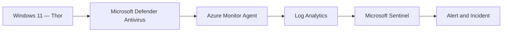
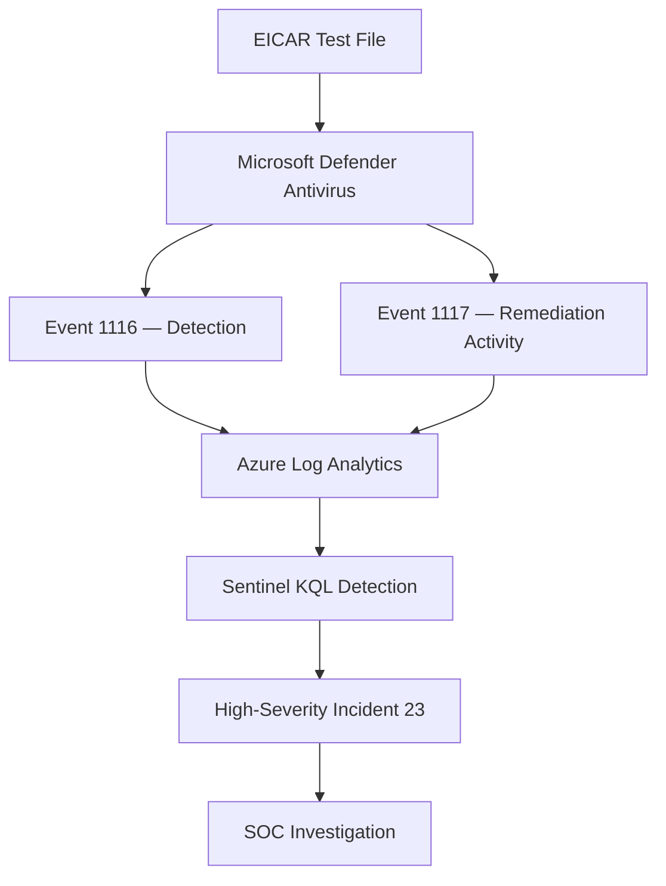

# Investigation 03 - Microsoft Defender Malware Detection

**Project:** Microsoft Sentinel Cloud SOC & Threat Detection  
**Endpoint:** Thor (Windows 11)  
**Severity:** High  
**Test:** EICAR Antivirus Test File

## Overview

Investigated Microsoft Defender Antivirus malware detection and remediation events using Microsoft Sentinel. A controlled EICAR test was performed on the Windows 11 endpoint `Thor` to validate antivirus monitoring.

Microsoft Defender generated Windows Events 1116 and 1117, which were collected through Azure Monitor Agent and analysed using a scheduled Microsoft Sentinel detection rule.

## Lab Architecture



## 1. Windows Event Log Analysis

| Event ID | Description |
|---|---|
| 1116 | Malware detection |
| 1117 | Malware remediation activity |

**KQL investigation query:**

```kusto
Event
| where EventID in (1116, 1117)
| project TimeGenerated, Computer, EventID, RenderedDescription
| order by TimeGenerated desc
```

Eight matching events were observed on `Thor`, including detection and remediation activity associated with:

`Virus:DOS/EICAR_Test_File`


## 2. Microsoft Sentinel Detection

**Analytics rule:** `SOC - Microsoft Defender Malware Detection`

**KQL detection rule:**

```kusto
Event
| where Source == "Microsoft-Windows-Windows Defender"
| where EventID in (1116, 1117)
| extend DetectionType = case(
    EventID == 1116, "Malware Detected",
    EventID == 1117, "Malware Remediation",
    "Unknown"
)
| project TimeGenerated, Computer, EventID,
          DetectionType, RenderedDescription
```

| Setting | Configuration |
|---|---|
| Rule type | Scheduled |
| Frequency | Every 5 minutes |
| Lookback | 15 minutes |
| Entity mapping | HostName → Computer |
| Incident severity | High |


## 3. Incident Investigation

Microsoft Sentinel generated high-severity incidents associated with the detection rule, including incident IDs **23, 24, 25, 26 and 28**.

**Selected incident:** 23

| Field | Finding |
|---|---|
| Severity | High |
| Status | Active |
| Classification | Unclassified |
| Associated alerts | 1 |
| Affected endpoint | Thor |
| Detection source | Microsoft Sentinel |


The incident's Assets tab confirmed `Thor` as the affected device.


## 4. Detection Workflow



## 5. MITRE ATT&CK Context

| Technique | ID | Relevance |
|---|---|---|
| User Execution | T1204 | Contextual reference for malware execution scenarios |

The EICAR test validated antivirus detection; it did not demonstrate a confirmed attacker technique or real malware infection.

## 6. Findings and Outcome

- Confirmed Microsoft Defender Antivirus detection of the EICAR test file.
- Verified Windows Security telemetry containing Events 1116 and 1117.
- Identified eight matching records in Azure Log Analytics.
- Validated the Microsoft Sentinel scheduled analytics rule.
- Confirmed high-severity incident generation.
- Investigated incident 23 and verified the affected endpoint `Thor`.

**Outcome:** Detection successfully validated using an authorised EICAR test. No confirmed malicious compromise.

## Skills Demonstrated

Microsoft Defender Antivirus · Microsoft Sentinel · KQL · Windows Event Analysis · Malware Detection · Incident Triage · Azure Log Analytics
