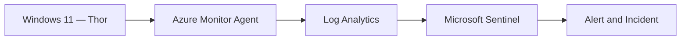
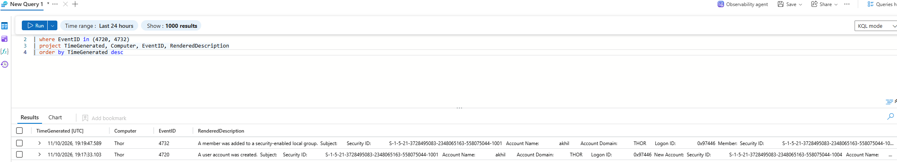
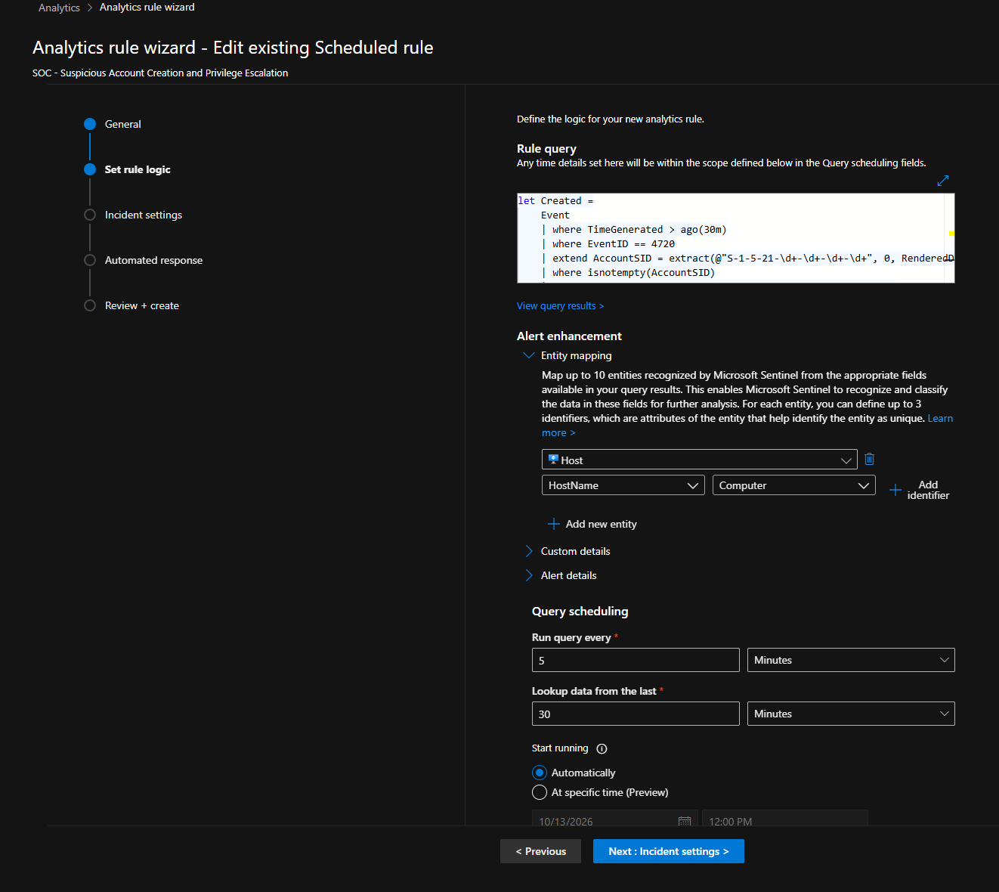
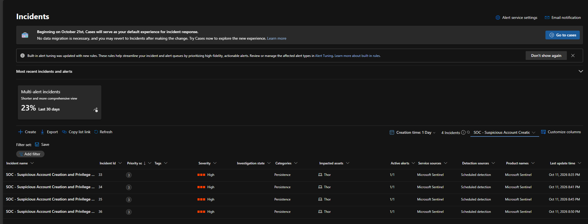
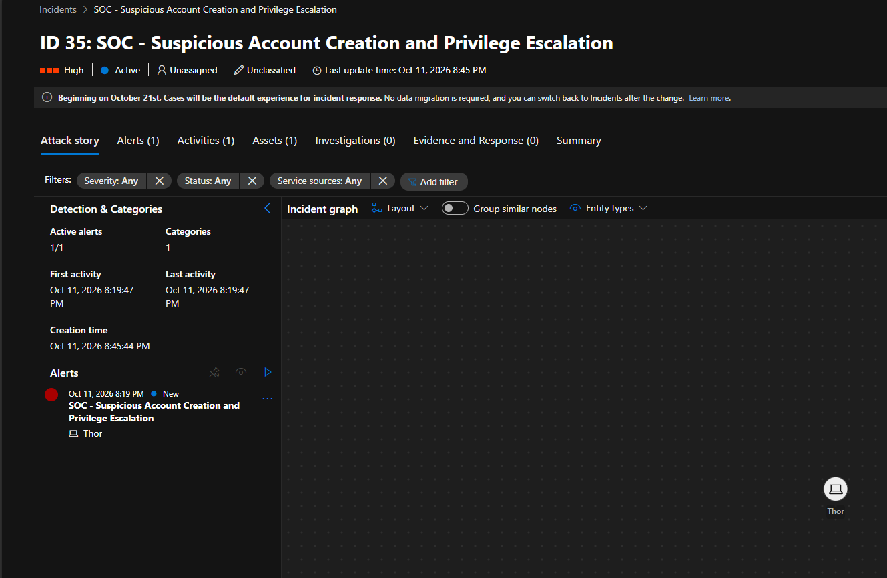
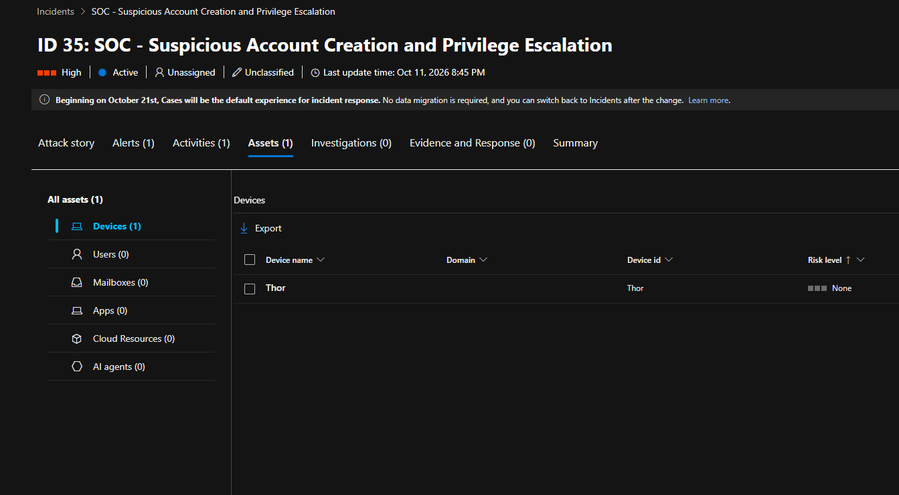
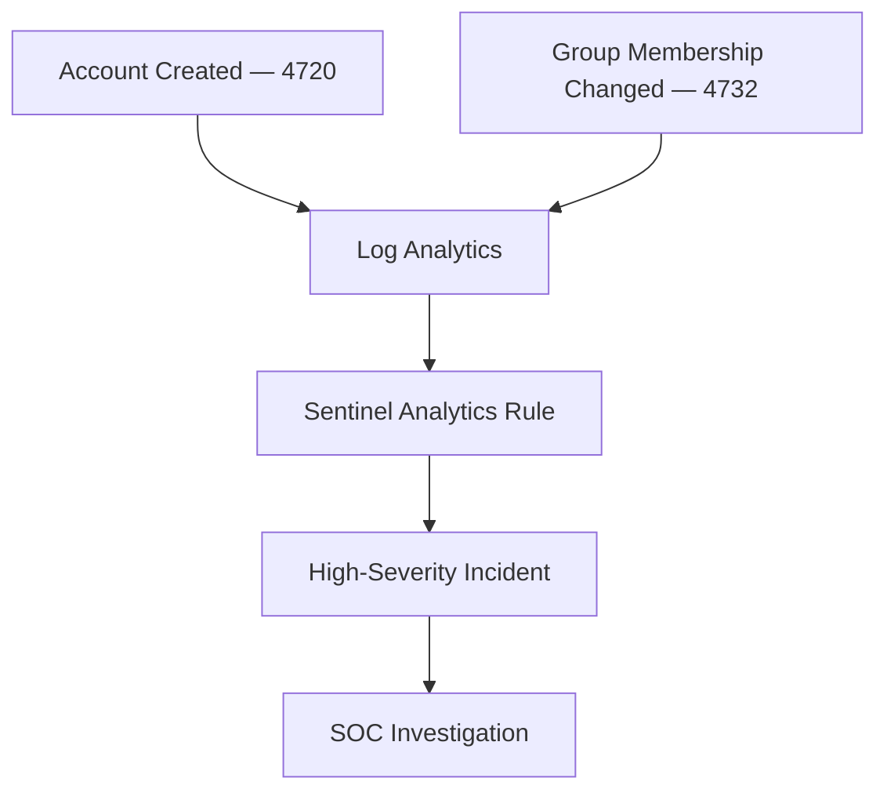

# Investigation 04 — Suspicious Account Creation and Privilege Escalation

**Project:** Microsoft Sentinel Cloud SOC Lab  
**Endpoint:** Thor (Windows 11)  
**Severity:** High  
**MITRE ATT&CK:** T1136.001, T1098

## Overview

Investigated suspicious Windows account creation and local group membership changes using Microsoft Sentinel. A controlled lab test generated Windows Security Events 4720 and 4732, which were collected in Azure Log Analytics and detected by a scheduled Sentinel analytics rule.

## Lab Architecture



## 1. Windows Event Log Analysis

| Event ID | Description |
|---|---|
| 4720 | A user account was created |
| 4732 | A member was added to a security-enabled local group |

**KQL investigation query:**

```kusto
Event
| where EventID in (4720, 4732)
| project TimeGenerated, Computer, EventID, RenderedDescription
| order by TimeGenerated desc
```

Both events were observed on `Thor` on 11 October 2026.



## 2. Microsoft Sentinel Detection

**Analytics rule:** `SOC - Suspicious Account Creation and Privilege Escalation`

| Setting | Configuration |
|---|---|
| Rule type | Scheduled |
| Frequency | Every 5 minutes |
| Lookback | 30 minutes |
| Entity mapping | HostName → Computer |
| Severity observed | High |

The rule processes account creation events and uses account SID extraction as part of its detection logic. The full saved query is not visible in the supplied evidence.



## 3. Incident Investigation

Microsoft Sentinel generated four high-severity incidents: **33, 34, 35 and 36**.



**Investigated incident:** 35

| Field | Finding |
|---|---|
| Severity | High |
| Status | Active |
| Classification | Unclassified |
| Alerts | 1 |
| Affected device | Thor |



The incident's asset view confirmed `Thor` as the affected endpoint.



## 4. Detection Workflow



## 5. MITRE ATT&CK Mapping

| Technique | ID |
|---|---|
| Create Account: Local Account | T1136.001 |
| Account Manipulation | T1098 |

## 6. Findings and Outcome

- Confirmed collection of Windows Security Events 4720 and 4732.
- Verified the scheduled Microsoft Sentinel detection rule.
- Confirmed high-severity incident generation.
- Identified `Thor` as the affected endpoint.
- Determined that the activity originated from an authorised lab simulation.

**Outcome:** Detection validated. No confirmed malicious compromise.

## Skills Demonstrated

Windows Event Log Analysis · KQL · Microsoft Sentinel · Account Monitoring · Incident Triage · MITRE ATT&CK
