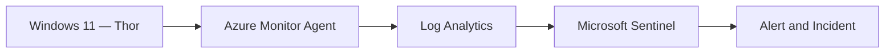
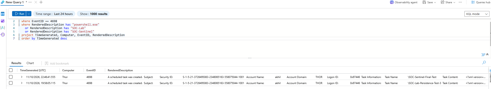
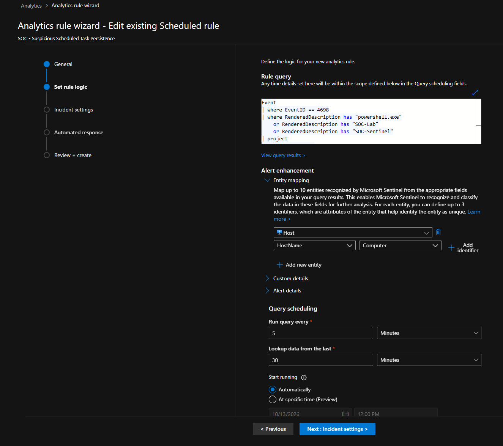
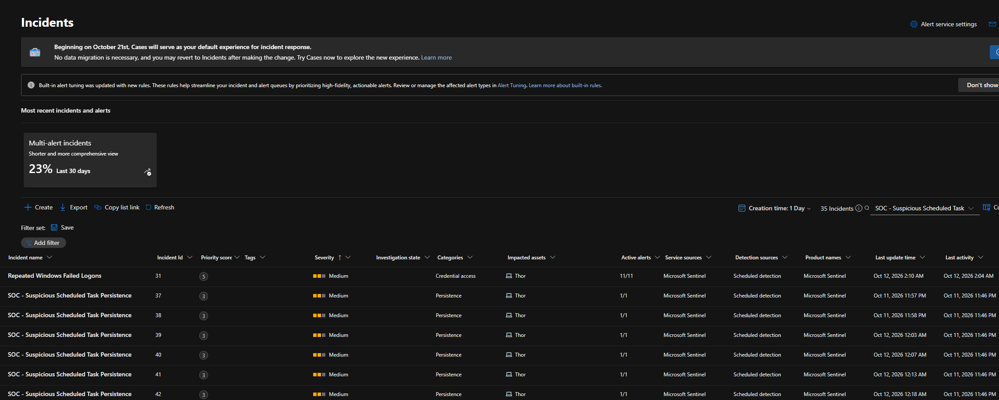
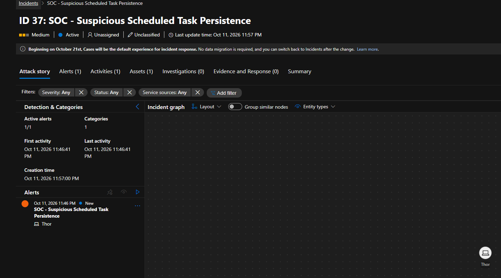
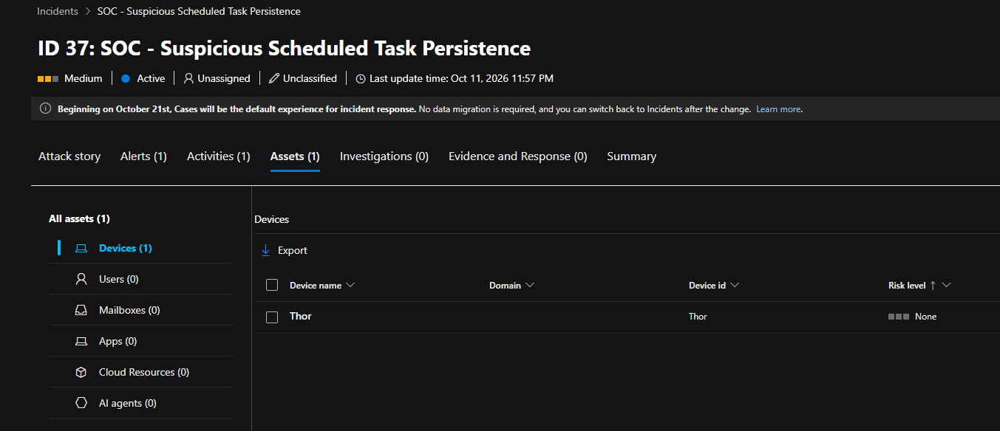
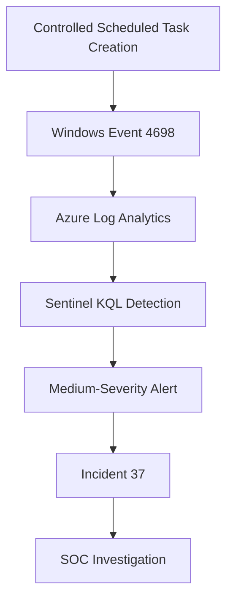

# Investigation 05 — Suspicious Scheduled Task Persistence

**Project:** Microsoft Sentinel Cloud SOC & Threat Detection  
**Endpoint:** Thor (Windows 11)  
**Severity:** Medium  
**MITRE ATT&CK:** T1053.005 — Scheduled Task/Job: Scheduled Task

## Overview

Investigated suspicious Windows scheduled task creation using Microsoft Sentinel. Controlled lab tasks were created on the Windows 11 endpoint `Thor` to simulate a persistence technique.

Windows Security Event 4698 was collected in Azure Log Analytics, and a scheduled Microsoft Sentinel analytics rule generated security incidents for investigation.

## Lab Architecture



## 1. Windows Event Log Analysis

**Event ID:** 4698 — A scheduled task was created.

The following KQL query was used to identify scheduled tasks containing selected PowerShell or lab indicators.

```kusto
Event
| where EventID == 4698
| where RenderedDescription has "powershell.exe"
    or RenderedDescription has "SOC-Lab"
    or RenderedDescription has "SOC-Sentinel"
| project TimeGenerated, Computer, EventID, RenderedDescription
| order by TimeGenerated desc
```

### Observed Results

Two matching events were identified on `Thor` on 11 October 2026.

| Scheduled task | Event ID |
|---|---|
| `SOC-Lab-Persistence-Test-3` | 4698 |
| `SOC-Sentinel-Final-Test` | 4698 |

Both records confirmed scheduled task creation during the controlled lab test.



## 2. Microsoft Sentinel Detection

**Analytics rule:** `SOC - Suspicious Scheduled Task Persistence`

| Setting | Configuration |
|---|---|
| Rule type | Scheduled |
| Frequency | Every 5 minutes |
| Lookback | 30 minutes |
| Entity mapping | HostName → Computer |
| Incident severity | Medium |

The detection rule monitors Event 4698 for scheduled task creation containing `powershell.exe`, `SOC-Lab` or `SOC-Sentinel`.



## 3. Incident Investigation

Microsoft Sentinel generated multiple medium-severity incidents. Incident IDs **37–42** are visible in the incident list.



**Selected incident:** 37

| Field | Finding |
|---|---|
| Severity | Medium |
| Status | Active |
| Classification | Unclassified |
| Associated alerts | 1 |
| Affected endpoint | Thor |
| Detection source | Microsoft Sentinel |

The incident's attack-story view confirmed an alert associated with suspicious scheduled task persistence.



The asset view identified `Thor` as the affected device.



## 4. Detection Workflow



## 5. MITRE ATT&CK Mapping

| Technique | ID | Relevance |
|---|---|---|
| Scheduled Task/Job: Scheduled Task | T1053.005 | Scheduled tasks can be used to execute commands and maintain persistence |

## 6. Findings and Outcome

- Confirmed collection of Windows Security Event 4698.
- Identified two scheduled task creation records on `Thor`.
- Validated the Microsoft Sentinel analytics rule.
- Confirmed medium-severity incident generation.
- Investigated incident 37 and verified the affected endpoint.
- Confirmed the activity originated from an authorised lab simulation.

**Outcome:** Detection successfully validated. No confirmed malicious compromise.

## Skills Demonstrated

Windows Event Log Analysis · Microsoft Sentinel · KQL · Persistence Detection · Incident Triage · MITRE ATT&CK · SOC Investigation
